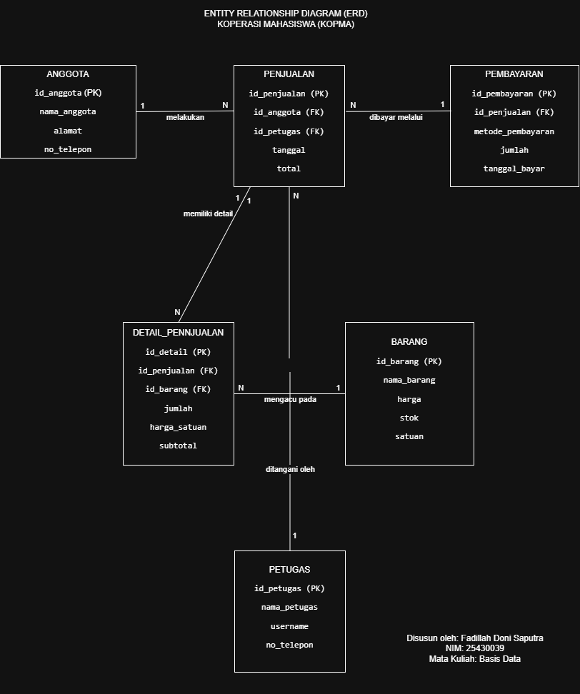
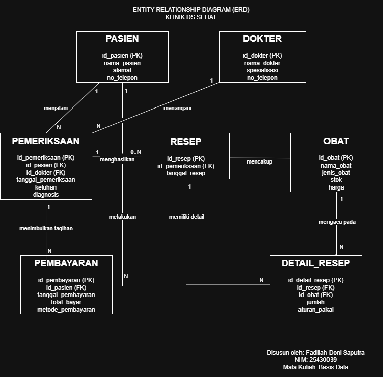

# LAPORAN PRAKTIKUM BASIS DATA
## MODUL 3 — PEMODELAN DATA DENGAN ENTITY-RELATIONSHIP DIAGRAM (ERD)

**Nama:** Fadillah Doni Saputra  
**NPM:** 25430039  
**Kelas:** B  
**Mata Kuliah:** Basis Data  
**Dosen Pengampu:** Dedi Irawan, S.Kom., M.T.I.  
**Objek Praktikum:** Kopma dan Klinik DS Sehat

---

## 1. Tujuan Praktikum

Praktikum ini bertujuan untuk memahami pemodelan data menggunakan Entity-Relationship Diagram (ERD). Melalui praktikum ini, mahasiswa diharapkan mampu mengidentifikasi entitas, atribut, primary key, foreign key, hubungan antarentitas, serta kardinalitas dalam suatu sistem.

Praktikum ini juga bertujuan untuk menerapkan konsep ERD pada dua studi kasus, yaitu Koperasi Mahasiswa (Kopma) dan Klinik DS Sehat. Hasil pemodelan digunakan sebagai dasar dalam perancangan basis data sebelum dilanjutkan ke tahap normalisasi dan implementasi tabel.

## 2. Dasar Teori

Entity-Relationship Diagram (ERD) merupakan diagram yang digunakan untuk menggambarkan struktur data dalam suatu sistem. ERD menunjukkan entitas, atribut, serta hubungan antarentitas yang diperlukan dalam perancangan basis data.

Entitas adalah objek yang datanya disimpan dalam basis data, seperti pasien, dokter, anggota, dan barang. Atribut merupakan karakteristik yang menjelaskan suatu entitas, misalnya nama, alamat, dan nomor telepon.

Primary Key (PK) adalah atribut yang berfungsi sebagai identitas unik setiap data dalam suatu entitas. Sementara itu, Foreign Key (FK) merupakan atribut yang menghubungkan suatu entitas dengan entitas lain.

Hubungan antarentitas disebut relationship. Kardinalitas menjelaskan jumlah keterkaitan data antarentitas, misalnya one-to-one (1:1), one-to-many (1), dan many-to-many (M). Hubungan many-to-many umumnya dipecah menggunakan entitas penghubung agar dapat diterapkan dalam rancangan tabel basis data.

ERD membantu perancang memahami kebutuhan data dan hubungan antarbagian sistem sebelum membuat tabel. Oleh karena itu, ERD perlu disusun berdasarkan kebutuhan sistem, dilengkapi atribut yang sesuai, serta menggunakan primary key, foreign key, dan kardinalitas yang tepat.

## 3. Langkah Kerja

### 3.1 Persiapan Praktikum

Sebelum membuat ERD, dilakukan persiapan dengan membuka aplikasi draw.io melalui browser. Aplikasi ini digunakan untuk menggambarkan entitas, atribut, serta hubungan antarentitas secara visual.

Selanjutnya, disiapkan dua studi kasus, yaitu Koperasi Mahasiswa (Kopma) dan Klinik DS Sehat. Setiap studi kasus dimodelkan berdasarkan kebutuhan data yang telah diidentifikasi sebelumnya.

### 3.2 Pembuatan ERD Kopma

ERD Kopma dibuat dengan mengidentifikasi entitas yang diperlukan dalam proses transaksi koperasi. Entitas yang digunakan meliputi ANGGOTA, BARANG, PENJUALAN, DETAIL_PENJUALAN, PEMBAYARAN, dan PETUGAS.

Setiap entitas dilengkapi atribut yang sesuai. Atribut kunci utama ditandai dengan PK, sedangkan atribut kunci asing ditandai dengan FK. Selanjutnya, entitas dihubungkan berdasarkan hubungan yang terjadi dalam proses bisnis koperasi.

### 3.3 Pembuatan ERD Klinik DS Sehat

ERD Klinik DS Sehat dibuat untuk menggambarkan pengelolaan data pasien, dokter, pemeriksaan, resep, obat, dan pembayaran. Entitas yang digunakan meliputi PASIEN, DOKTER, PEMERIKSAAN, RESEP, OBAT, DETAIL_RESEP, dan PEMBAYARAN.

Hubungan antarentitas dibuat berdasarkan proses pelayanan klinik. Entitas DETAIL_RESEP digunakan sebagai penghubung antara RESEP dan OBAT karena satu resep dapat memuat beberapa obat, sedangkan satu jenis obat dapat digunakan dalam banyak resep.

### 3.4 Penentuan Kardinalitas

Setelah hubungan antarentitas dibuat, kardinalitas ditentukan untuk menjelaskan jumlah keterkaitan data. Kardinalitas ditandai dengan angka 1 dan N sesuai dengan aturan hubungan masing-masing entitas.

Tahap ini penting agar rancangan ERD dapat menggambarkan kebutuhan data dengan benar dan menjadi dasar untuk tahap normalisasi berikutnya.

## 4. Hasil dan Pembahasan

### 4.1 Hasil ERD Kopma

ERD Kopma menggambarkan hubungan data anggota, barang, penjualan, detail penjualan, pembayaran, dan petugas. Setiap entitas memiliki atribut yang digunakan untuk menyimpan informasi sesuai kebutuhan sistem koperasi.

**Gambar 4.1. ERD Kopma**

### 4.2 Hasil ERD Klinik DS Sehat

ERD Klinik DS Sehat menggambarkan hubungan data pasien, dokter, pemeriksaan, resep, obat, detail resep, dan pembayaran. Entitas-entitas tersebut digunakan untuk mendukung pencatatan pelayanan pasien, pemeriksaan dokter, pemberian resep, penggunaan obat, dan transaksi pembayaran.

**Gambar 4.2. ERD Klinik DS Sehat**

## 5. Analisis Hubungan dan Kardinalitas

### 5.1 Analisis ERD Kopma

| No. | Hubungan Entitas | Kardinalitas | Penjelasan |
|---:|---|:---:|---|
| 1 | ANGGOTA – PENJUALAN | 1:N | Satu anggota dapat melakukan beberapa transaksi penjualan. |
| 2 | PETUGAS – PENJUALAN | 1:N | Satu petugas dapat menangani beberapa transaksi penjualan. |
| 3 | PENJUALAN – DETAIL_PENJUALAN | 1:N | Satu transaksi penjualan dapat memiliki beberapa detail barang. |
| 4 | BARANG – DETAIL_PENJUALAN | 1:N | Satu barang dapat muncul pada banyak detail penjualan. |
| 5 | PENJUALAN – PEMBAYARAN | 1:N | Satu transaksi penjualan dapat memiliki catatan pembayaran sesuai kebutuhan sistem. |

### 5.2 Analisis ERD Klinik DS Sehat

| No. | Hubungan Entitas | Kardinalitas | Penjelasan |
|---:|---|:---:|---|
| 1 | PASIEN – PEMERIKSAAN | 1:N | Satu pasien dapat menjalani beberapa pemeriksaan. |
| 2 | DOKTER – PEMERIKSAAN | 1:N | Satu dokter dapat menangani beberapa pemeriksaan. |
| 3 | PEMERIKSAAN – RESEP | 1:N | Satu pemeriksaan dapat menghasilkan resep jika diperlukan. |
| 4 | RESEP – DETAIL_RESEP | 1:N | Satu resep dapat memiliki beberapa detail obat. |
| 5 | OBAT – DETAIL_RESEP | 1:N | Satu jenis obat dapat digunakan dalam banyak detail resep. |
| 6 | PASIEN – PEMBAYARAN | 1:N | Satu pasien dapat memiliki beberapa transaksi pembayaran. |
| 7 | PEMERIKSAAN – PEMBAYARAN | 1:N | Satu pemeriksaan dapat memiliki catatan pembayaran sesuai rancangan sistem. |

Kardinalitas tersebut menggambarkan hubungan data dalam masing-masing sistem. Penetapan akhir perlu disesuaikan dengan kebutuhan data yang telah dibuat pada Modul 2 dan aturan bisnis yang digunakan.

## 6. Kesimpulan

Praktikum pemodelan data menggunakan Entity-Relationship Diagram (ERD) membantu memahami struktur data dan hubungan antarentitas dalam suatu sistem. ERD Kopma menggambarkan data anggota, barang, penjualan, pembayaran, dan petugas, sedangkan ERD Klinik DS Sehat menggambarkan data pasien, dokter, pemeriksaan, resep, obat, dan pembayaran.

Melalui praktikum ini, penggunaan atribut, primary key, foreign key, serta kardinalitas dapat diterapkan sebagai dasar perancangan basis data. Rancangan ERD selanjutnya perlu diperiksa kembali berdasarkan kebutuhan data dan dilanjutkan ke tahap normalisasi.

## 7. Kendala Praktikum

Kendala yang ditemui selama praktikum adalah mengatur posisi entitas dan garis relasi agar diagram mudah dibaca. Selain itu, penentuan kardinalitas perlu dilakukan dengan teliti agar sesuai dengan kebutuhan data setiap sistem.

Kendala tersebut diatasi dengan menyusun entitas secara teratur, memberi label pada setiap relasi, serta memeriksa kembali hubungan antarentitas sebelum diagram disimpan.

## 8. Pernyataan Penggunaan AI

Dalam penyusunan laporan ini, AI digunakan sebagai alat bantu untuk memahami konsep ERD, menyusun penjelasan, dan merapikan struktur laporan. Hasil yang digunakan tetap perlu diperiksa dan disesuaikan dengan diagram, kebutuhan data, serta ketentuan praktikum yang sebenarnya.
