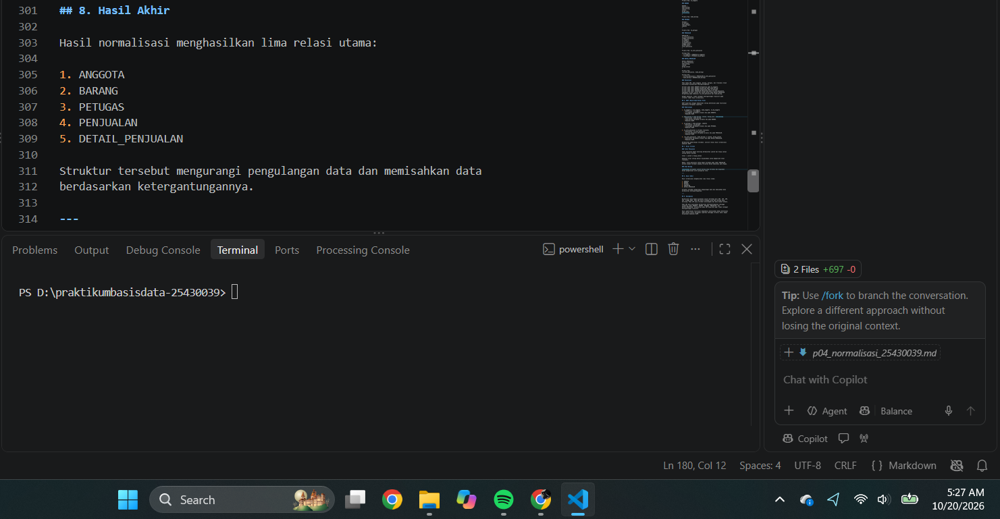
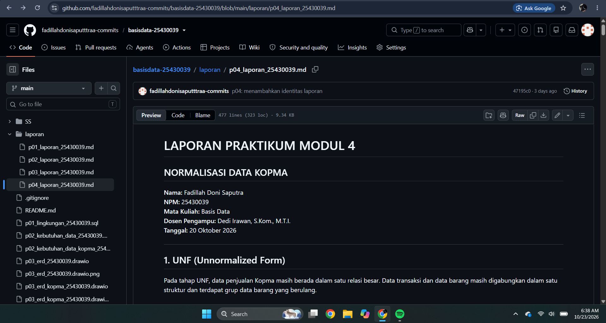

# LAPORAN PRAKTIKUM MODUL 4
## NORMALISASI DATA KOPMA

**Nama:** Fadillah Doni Saputra  
**NPM:** 25430039  
**Mata Kuliah:** Basis Data  
**Dosen Pengampu:** Dedi Irawan, S.Kom., M.T.I.  
**Tanggal:** 20 Oktober 2026  

---

## 1. UNF (Unnormalized Form)

Pada tahap Unnormalized Form (UNF), data penjualan Kopma masih berada dalam satu relasi besar. Data transaksi dan data barang masih digabungkan sehingga terdapat kelompok data barang yang berulang.

### NOTA_UNF

```text
NOTA_UNF(
    no_nota_penjualan,
    tgl_penjualan,
    kode_petugas,
    nama_petugas,
    no_anggota,
    nama_anggota,
    {
        kode_barang,
        nama_barang,
        qty_detail_penjualan,
        harga_satuan_detail_penjualan,
        subtotal_detail_penjualan
    },
    jumlah_penjualan,
    diskon_penjualan,
    total_penjualan
)
```

Tanda `{}` menunjukkan kelompok data yang dapat berulang karena satu nota dapat memiliki lebih dari satu barang.

### Bukti Screenshot UNF


---

## 2. 1NF (First Normal Form)

Pada tahap 1NF, kelompok data berulang dihilangkan sehingga setiap atribut memiliki nilai yang atomik.

### NOTA_1NF

```text
NOTA_1NF(
    no_nota_penjualan,
    kode_barang,
    tgl_penjualan,
    kode_petugas,
    nama_petugas,
    no_anggota,
    nama_anggota,
    nama_barang,
    qty_detail_penjualan,
    harga_satuan_detail_penjualan,
    subtotal_detail_penjualan,
    jumlah_penjualan,
    diskon_penjualan,
    total_penjualan
)
```

Primary Key:

```text
(no_nota_penjualan, kode_barang)
```

Setiap baris pada relasi menunjukkan satu barang pada satu transaksi.

### Bukti Screenshot 1NF


---

## 3. 2NF (Second Normal Form)

Pada tahap 2NF, ketergantungan sebagian terhadap primary key komposit dihilangkan dengan memisahkan data menjadi beberapa relasi.

Relasi yang dihasilkan:

### ANGGOTA

```text
ANGGOTA(
    no_anggota,
    nama_anggota
)
```

### PETUGAS

```text
PETUGAS(
    kode_petugas,
    nama_petugas
)
```

### BARANG

```text
BARANG(
    kode_barang,
    nama_barang
)
```

### PENJUALAN

```text
PENJUALAN(
    no_nota_penjualan,
    tgl_penjualan,
    kode_petugas,
    no_anggota
)
```

### DETAIL_PENJUALAN

```text
DETAIL_PENJUALAN(
    no_nota_penjualan,
    kode_barang,
    qty_detail_penjualan,
    harga_satuan_detail_penjualan
)
```

Pemisahan tersebut dilakukan agar atribut yang hanya bergantung pada sebagian kunci komposit tidak lagi berada dalam relasi yang sama.

### Bukti Screenshot 2NF


---

## 4. Functional Dependency

Functional Dependency digunakan untuk menunjukkan hubungan ketergantungan antaratribut dalam data.

### FD Data Penjualan

```text
no_nota_penjualan → tgl_penjualan, kode_petugas, no_anggota
```

### FD Data Petugas

```text
kode_petugas → nama_petugas
```

### FD Data Anggota

```text
no_anggota → nama_anggota
```

### FD Data Barang

```text
kode_barang → nama_barang
```

### FD Detail Penjualan

```text
(no_nota_penjualan, kode_barang)
→ qty_detail_penjualan, harga_satuan_detail_penjualan
```

### FD Subtotal

```text
qty_detail_penjualan, harga_satuan_detail_penjualan
→ subtotal_detail_penjualan
```

Dependensi tersebut digunakan sebagai dasar dalam proses pemisahan relasi.

### Bukti Screenshot Functional Dependency


---

## 5. 3NF (Third Normal Form)

Pada tahap 3NF, ketergantungan transitif dihilangkan. Setiap atribut non-key harus bergantung langsung pada primary key.

### ANGGOTA

```text
ANGGOTA(
    no_anggota PK,
    nama_anggota
)
```

### PETUGAS

```text
PETUGAS(
    kode_petugas PK,
    nama_petugas
)
```

### BARANG

```text
BARANG(
    kode_barang PK,
    nama_barang
)
```

### PENJUALAN

```text
PENJUALAN(
    no_nota_penjualan PK,
    tgl_penjualan,
    kode_petugas FK,
    no_anggota FK
)
```

### DETAIL_PENJUALAN

```text
DETAIL_PENJUALAN(
    no_nota_penjualan PK/FK,
    kode_barang PK/FK,
    qty_detail_penjualan,
    harga_satuan_detail_penjualan
)
```

Dengan struktur tersebut, atribut non-key pada setiap relasi bergantung langsung pada primary key relasi masing-masing.

### Bukti Screenshot 3NF


---

## 6. BCNF (Boyce-Codd Normal Form)

BCNF merupakan tahap pemeriksaan lanjutan untuk memastikan setiap determinan pada functional dependency merupakan superkey.

### ANGGOTA

```text
no_anggota → nama_anggota
```

Determinan `no_anggota` merupakan primary key.

**Memenuhi BCNF.**

### PETUGAS

```text
kode_petugas → nama_petugas
```

Determinan `kode_petugas` merupakan primary key.

**Memenuhi BCNF.**

### BARANG

```text
kode_barang → nama_barang
```

Determinan `kode_barang` merupakan primary key.

**Memenuhi BCNF.**

### PENJUALAN

```text
no_nota_penjualan
→ tgl_penjualan, kode_petugas, no_anggota
```

Determinan `no_nota_penjualan` merupakan primary key.

**Memenuhi BCNF.**

### DETAIL_PENJUALAN

```text
(no_nota_penjualan, kode_barang)
→ qty_detail_penjualan, harga_satuan_detail_penjualan
```

Determinan tersebut merupakan primary key.

**Memenuhi BCNF.**

### Bukti Screenshot BCNF


---

## 7. Nilai Turunan

Nilai turunan merupakan nilai yang dapat diperoleh melalui perhitungan dari atribut lain.

### Subtotal

```text
subtotal_detail_penjualan =
qty_detail_penjualan × harga_satuan_detail_penjualan
```

### Total Penjualan

```text
total_penjualan =
Σ subtotal_detail_penjualan
```

Nilai subtotal dan total dapat dihitung berdasarkan data detail transaksi.

### Bukti Screenshot Nilai Turunan


---

## 8. Hasil Akhir

Hasil akhir normalisasi menghasilkan beberapa relasi utama:

1. ANGGOTA
2. PETUGAS
3. BARANG
4. PENJUALAN
5. DETAIL_PENJUALAN

### Skema Relasional

```text
ANGGOTA(
    no_anggota PK,
    nama_anggota
)

PETUGAS(
    kode_petugas PK,
    nama_petugas
)

BARANG(
    kode_barang PK,
    nama_barang
)

PENJUALAN(
    no_nota_penjualan PK,
    tgl_penjualan,
    kode_petugas FK,
    no_anggota FK
)

DETAIL_PENJUALAN(
    no_nota_penjualan PK/FK,
    kode_barang PK/FK,
    qty_detail_penjualan,
    harga_satuan_detail_penjualan
)
```

### Relasi Antar Tabel

```text
ANGGOTA 1 ──── N PENJUALAN
PETUGAS 1 ──── N PENJUALAN
PENJUALAN 1 ──── N DETAIL_PENJUALAN
BARANG 1 ──── N DETAIL_PENJUALAN
```

### Bukti Screenshot Hasil Akhir



---

## 9. Bukti Git

Bukti Git digunakan untuk menunjukkan bahwa file hasil praktikum telah dimasukkan ke repository GitHub.

Repository:

```text
basisdata-25430039
```

Branch:

```text
main
```

Commit terakhir yang digunakan untuk perubahan laporan dan file P04 dapat dilihat melalui Git.

### Bukti Screenshot Git



---

## 10. Kesimpulan

Normalisasi data Kopma dilakukan secara bertahap mulai dari UNF, 1NF, 2NF, 3NF, hingga BCNF.

Pada UNF masih terdapat kelompok data barang yang berulang. Pada 1NF data dibuat atomik. Pada 2NF ketergantungan sebagian terhadap primary key komposit dihilangkan dengan memisahkan data ke dalam beberapa relasi.

Pada 3NF ketergantungan transitif dihilangkan sehingga atribut non-key bergantung langsung pada primary key. Selanjutnya dilakukan pemeriksaan BCNF untuk memastikan setiap determinan merupakan superkey.

Hasil akhir menghasilkan relasi ANGGOTA, PETUGAS, BARANG, PENJUALAN, dan DETAIL_PENJUALAN. Relasi tersebut dihubungkan menggunakan primary key dan foreign key sehingga data menjadi lebih terstruktur dan mengurangi pengulangan data.