# LAPORAN PRAKTIKUM BASIS DATA

## MODUL 4 – NORMALISASI DAN SKEMA RELASIONAL

**Nama:** Fadillah Doni Saputra  
**NPM:** 25430039  
**Mata Kuliah:** Basis Data  
**Dosen Pengampu:** Dedi Irawan, S.Kom., M.T.I.  
**Kelas:** B  
**Pertemuan:** 4  
**Tanggal:** 20 Oktober 2026  

---

# BAB I
## PENDAHULUAN

### 1.1 Latar Belakang

Basis data digunakan untuk menyimpan dan mengelola data agar dapat digunakan secara terstruktur. Dalam sebuah sistem informasi, data yang disimpan harus memiliki struktur yang baik sehingga tidak terjadi pengulangan data, inkonsistensi, maupun kesulitan ketika data diperbarui.

Salah satu proses penting dalam perancangan basis data adalah **normalisasi**. Normalisasi merupakan proses pengorganisasian data ke dalam beberapa tabel berdasarkan ketergantungan antar atribut. Tujuannya adalah mengurangi redundansi data dan menjaga integritas data.

Pada Modul 4 dilakukan proses normalisasi data transaksi penjualan dari bentuk tidak ternormalisasi atau **Unnormalized Form (UNF)** sampai dengan **Third Normal Form (3NF)**. Proses tersebut dilakukan dengan menganalisis atribut, menentukan functional dependency, memisahkan kelompok data yang berulang, serta menentukan primary key dan hubungan antar tabel.

Selain proses normalisasi, pada praktikum juga dilakukan identifikasi **nilai turunan** dan penyusunan **skema relasional** sebagai hasil akhir dari proses normalisasi.

### 1.2 Tujuan Praktikum

Praktikum ini bertujuan untuk:

1. Memahami konsep normalisasi database.
2. Mengidentifikasi data yang masih berada dalam bentuk UNF.
3. Mengubah data dari UNF menjadi 1NF.
4. Mengubah 1NF menjadi 2NF.
5. Mengubah 2NF menjadi 3NF.
6. Menentukan functional dependency antar atribut.
7. Mengidentifikasi atribut yang merupakan nilai turunan.
8. Menentukan primary key pada setiap tabel.
9. Membentuk skema relasional hasil normalisasi.
10. Memahami manfaat normalisasi dalam perancangan database.

---

# BAB II
## DASAR TEORI

### 2.1 Normalisasi

Normalisasi adalah proses penyusunan struktur tabel database untuk mengurangi redundansi data dan mencegah masalah pada proses insert, update, dan delete.

Normalisasi dilakukan secara bertahap dengan menggunakan beberapa bentuk normal.

### 2.2 Unnormalized Form (UNF)

UNF merupakan bentuk data yang belum ternormalisasi. Pada bentuk ini masih terdapat kelompok atribut berulang atau repeating group dalam satu record.

Contohnya pada transaksi penjualan, satu nomor nota dapat memiliki beberapa barang. Data barang tersebut dapat muncul berulang dalam satu transaksi.

### 2.3 First Normal Form (1NF)

Sebuah tabel dikatakan memenuhi 1NF apabila setiap atribut memiliki nilai yang atomik atau tidak terdapat kelompok data berulang dalam satu kolom.

Dengan demikian, data yang sebelumnya berupa repeating group harus dipisahkan sehingga setiap baris mewakili satu nilai untuk setiap atribut.

### 2.4 Second Normal Form (2NF)

2NF merupakan bentuk normal yang sudah memenuhi 1NF dan setiap atribut non-key harus bergantung sepenuhnya pada primary key.

Pada tabel dengan primary key gabungan, atribut yang hanya bergantung pada sebagian primary key harus dipisahkan ke tabel lain.

### 2.5 Third Normal Form (3NF)

3NF merupakan bentuk normal yang sudah memenuhi 2NF dan tidak memiliki ketergantungan transitif.

Atribut non-key harus bergantung langsung pada primary key, bukan bergantung pada atribut non-key lainnya.

### 2.6 Functional Dependency

Functional dependency menunjukkan hubungan ketergantungan antara atribut. Jika suatu atribut menentukan atribut lainnya, maka atribut pertama disebut determinant.

Contohnya:

```text
kode_barang → nama_barang
```

Artinya `kode_barang` menentukan `nama_barang`.

### 2.7 Nilai Turunan

Nilai turunan merupakan nilai yang dapat diperoleh dari perhitungan atribut lain sehingga tidak selalu perlu disimpan secara langsung.

Contohnya total transaksi dapat diperoleh dari:

```text
jumlah × harga_satuan
```

---

# BAB III
## DATA AWAL DAN UNF

### 3.1 Relasi NOTA_UNF

Pada tahap awal, data transaksi penjualan masih berbentuk UNF. Relasi tersebut dapat dituliskan sebagai:

```text
NOTA_UNF
(
no_nota_penjualan,
tanggal_penjualan,
no_anggota,
nama_anggota,
id_petugas,
nama_petugas,
jabatan,
{
kode_barang,
nama_barang,
satuan,
jumlah,
harga_satuan
},
metode_pembayaran,
uang_bayar,
kembalian,
total_penjualan
)
```

Bagian yang berada di dalam tanda `{ }` merupakan **repeating group**, karena dalam satu transaksi dapat terdapat lebih dari satu barang.

### 3.2 Identifikasi Masalah UNF

Pada bentuk UNF terdapat beberapa masalah, antara lain:

1. Data barang dapat berulang dalam satu transaksi.
2. Informasi anggota dapat berulang untuk transaksi yang berbeda.
3. Informasi petugas dapat berulang.
4. Data transaksi dan data master masih bercampur.
5. Struktur belum efisien untuk digunakan sebagai database relasional.

### 3.3 Dokumentasi UNF

**Screenshot SS24**

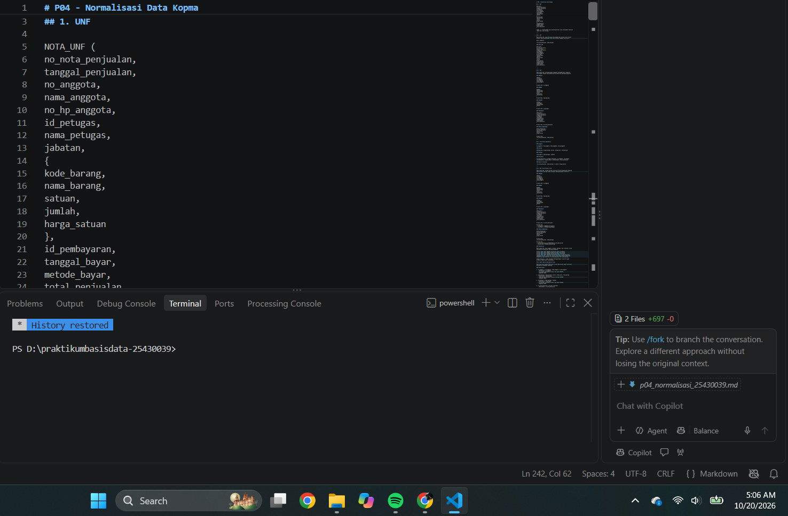

**Screenshot SS25**

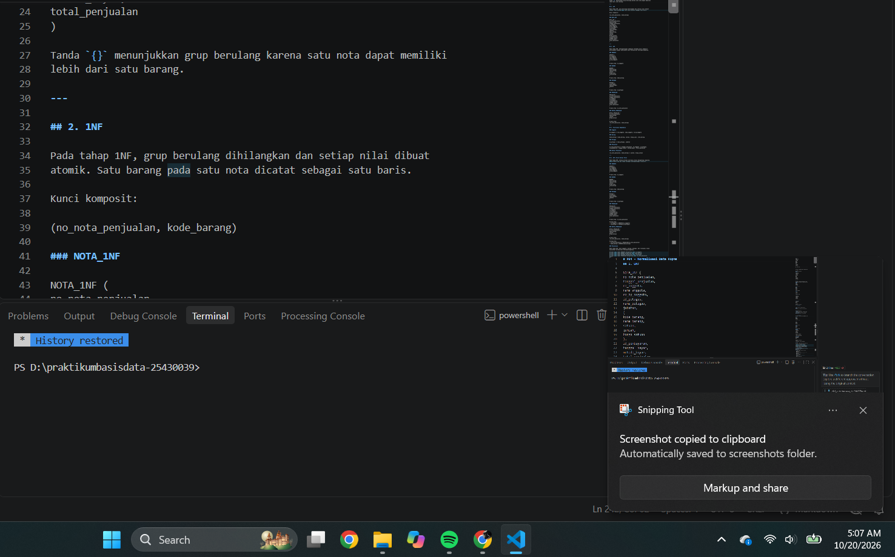

**Screenshot SS26**

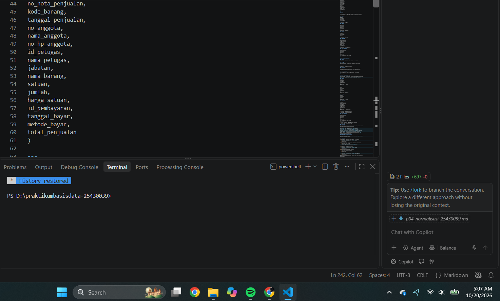

---

# BAB IV
## FIRST NORMAL FORM (1NF)

### 4.1 Proses Pembentukan 1NF

Untuk memenuhi 1NF, repeating group pada data transaksi harus dihilangkan. Setiap barang dalam sebuah transaksi dibuat menjadi baris tersendiri.

Dengan demikian, setiap nilai atribut menjadi atomik.

Contoh struktur:

```text
NOTA_1NF
(
no_nota_penjualan,
tanggal_penjualan,
no_anggota,
nama_anggota,
id_petugas,
nama_petugas,
jabatan,
kode_barang,
nama_barang,
satuan,
jumlah,
harga_satuan,
metode_pembayaran,
uang_bayar,
kembalian,
total_penjualan
)
```

### 4.2 Primary Key 1NF

Karena satu nota dapat mempunyai beberapa barang, kombinasi:

```text
no_nota_penjualan + kode_barang
```

dapat digunakan sebagai kandidat primary key untuk membedakan setiap detail barang dalam transaksi.

### 4.3 Dokumentasi 1NF

**Screenshot SS27**

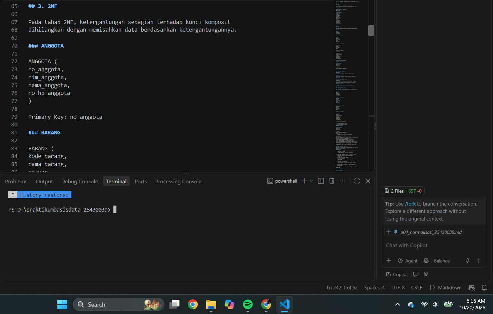

**Screenshot SS28**

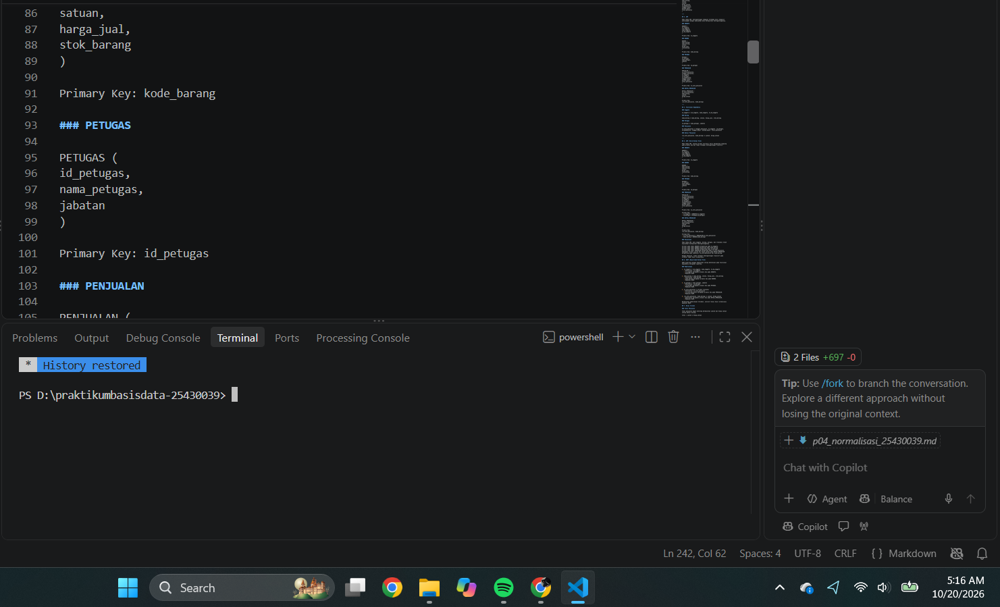

**Screenshot SS29**

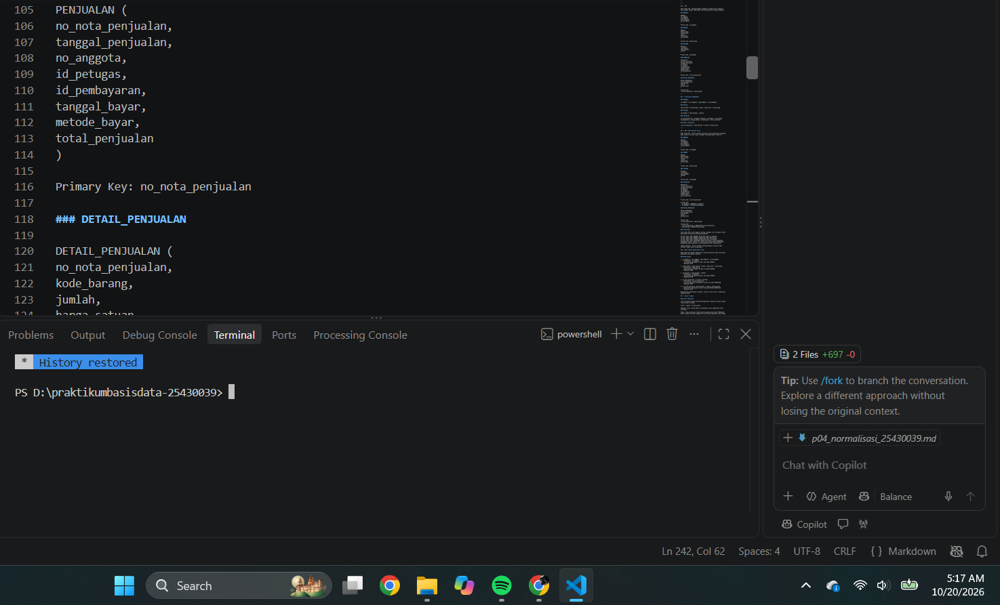

**Screenshot SS30**

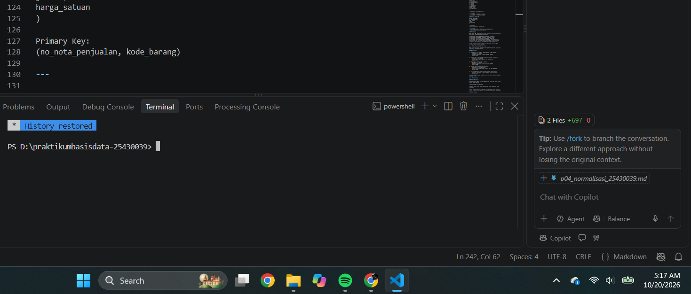

---

# BAB V
## FUNCTIONAL DEPENDENCY DAN SECOND NORMAL FORM

### 5.1 Functional Dependency

Setelah bentuk 1NF diperoleh, dilakukan analisis ketergantungan fungsional antar atribut.

Beberapa ketergantungan yang dapat ditemukan adalah:

```text
no_nota_penjualan → tanggal_penjualan
no_nota_penjualan → no_anggota
no_nota_penjualan → id_petugas
id_petugas → nama_petugas
id_petugas → jabatan
no_anggota → nama_anggota
kode_barang → nama_barang
kode_barang → satuan
kode_barang → harga_satuan
```

Ketergantungan tersebut menunjukkan bahwa beberapa atribut tidak bergantung sepenuhnya pada kombinasi primary key.

### 5.2 Dokumentasi Functional Dependency

**Screenshot SS31**

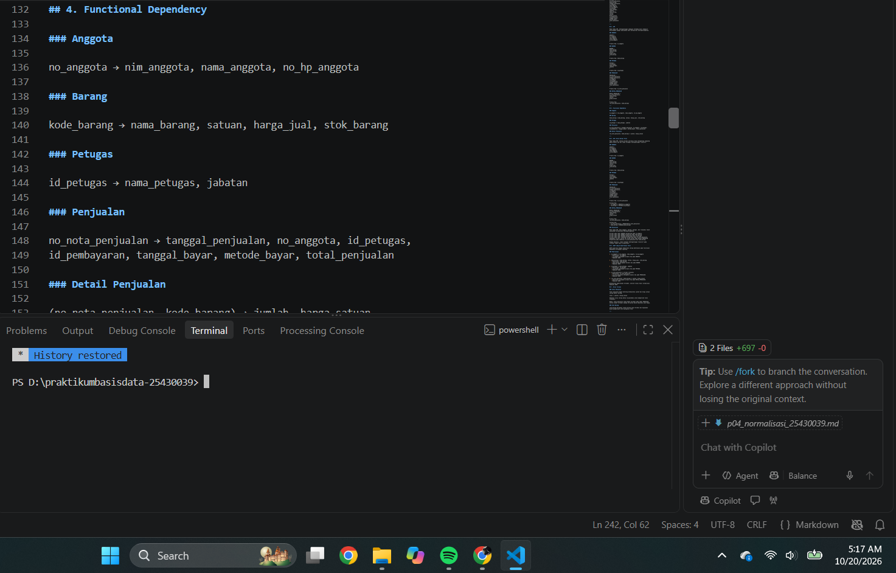

**Screenshot SS32**

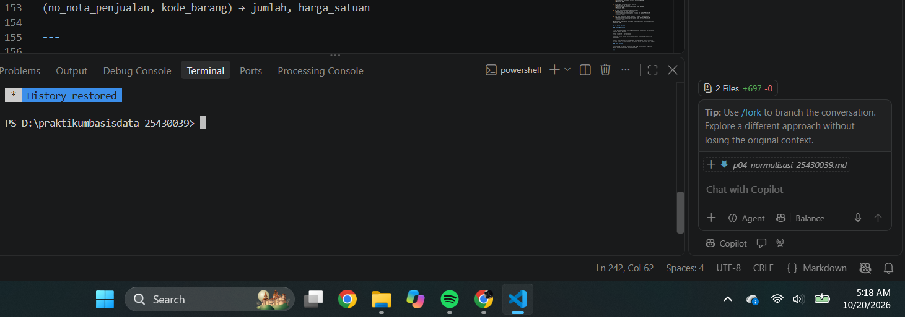

### 5.3 Pembentukan 2NF

Untuk mencapai 2NF, atribut yang hanya bergantung pada sebagian primary key dipisahkan ke tabel yang sesuai.

Data transaksi dipisahkan dari data barang dan data master lainnya.

Contoh hasil pemisahan:

```text
PETUGAS
(
id_petugas,
nama_petugas,
jabatan
)

ANGGOTA
(
no_anggota,
nama_anggota
)

BARANG
(
kode_barang,
nama_barang,
satuan,
harga_satuan
)

PENJUALAN
(
no_nota_penjualan,
tanggal_penjualan,
no_anggota,
id_petugas,
metode_pembayaran,
uang_bayar,
kembalian
)

DETAIL_PENJUALAN
(
no_nota_penjualan,
kode_barang,
jumlah,
harga_satuan
)
```

### 5.4 Dokumentasi 2NF

**Screenshot SS33**

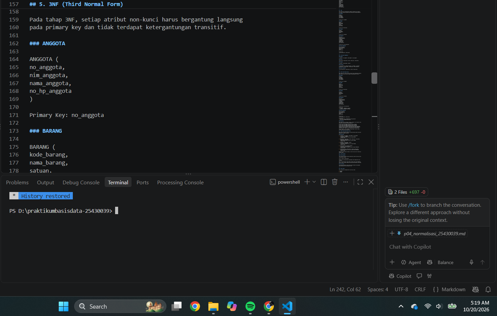

**Screenshot SS34**

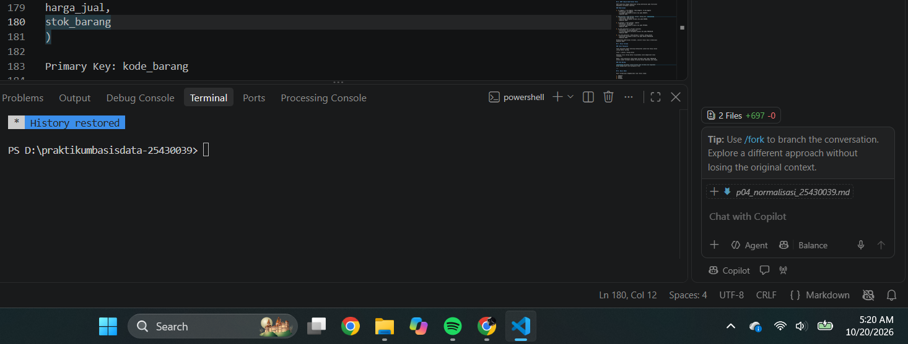

**Screenshot SS35**

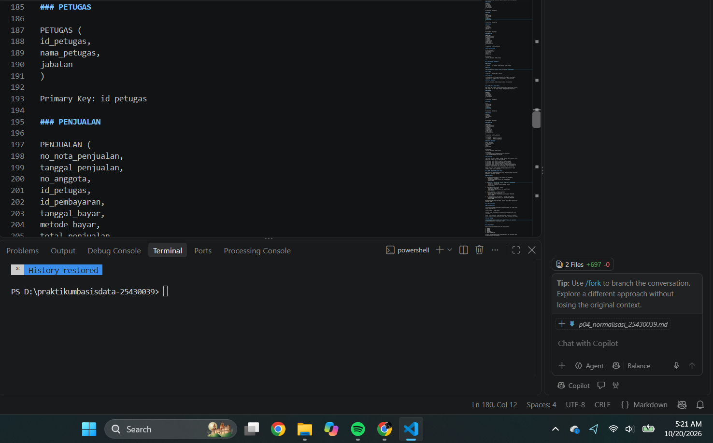

**Screenshot SS36**

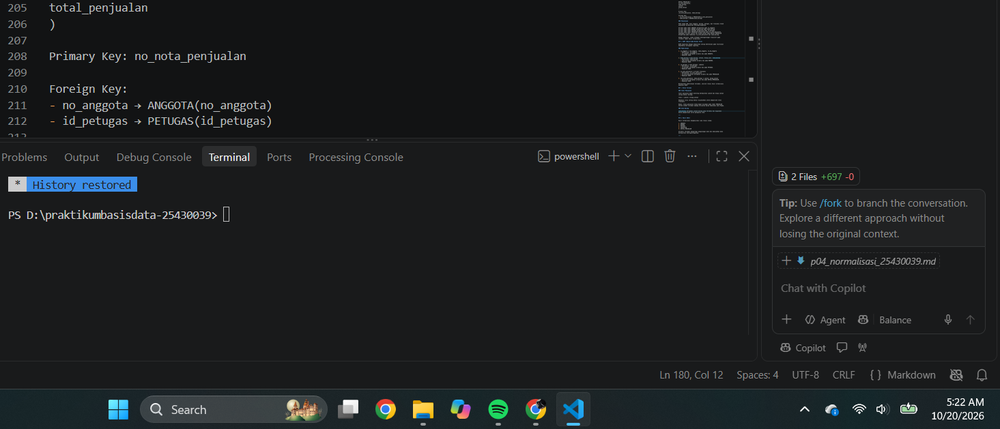

**Screenshot SS37**

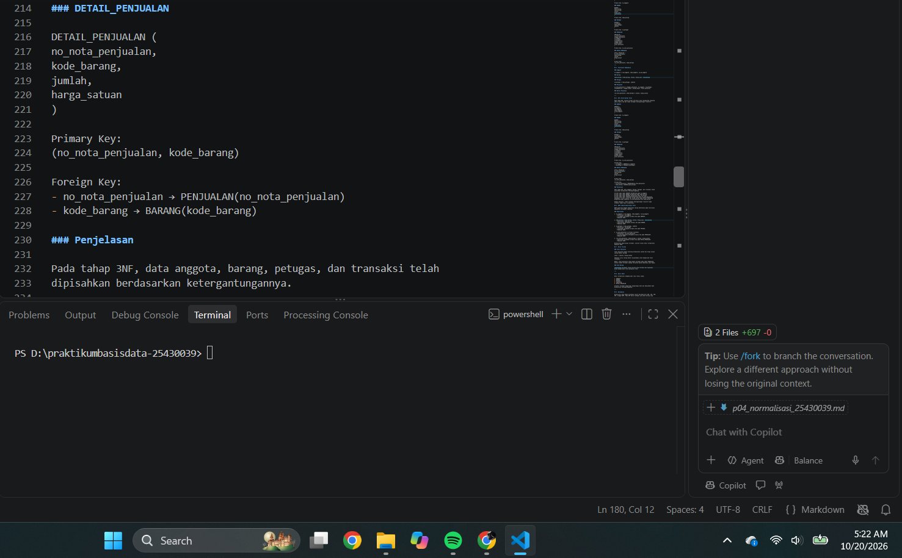

**Screenshot SS38**

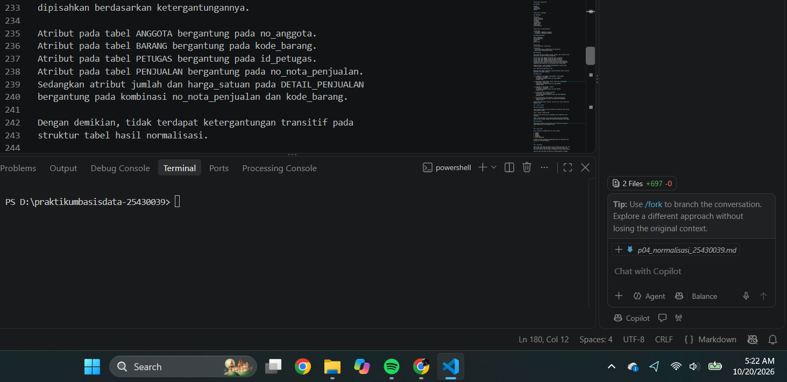

---

# BAB VI
## THIRD NORMAL FORM (3NF)

### 6.1 Ketergantungan Transitif

Pada tahap 3NF dilakukan pemeriksaan terhadap ketergantungan transitif.

Contohnya:

```text
id_petugas → nama_petugas
id_petugas → jabatan
```

Informasi nama dan jabatan petugas tidak perlu disimpan berulang pada tabel transaksi karena sudah dapat diperoleh melalui tabel petugas.

Begitu juga:

```text
no_anggota → nama_anggota
```

Informasi anggota dipisahkan ke tabel anggota.

### 6.2 Pemisahan Tabel

Hasil normalisasi menghasilkan tabel-tabel yang memiliki fungsi masing-masing.

#### Tabel PETUGAS

```text
PETUGAS
(
id_petugas,
nama_petugas,
jabatan
)
```

#### Tabel ANGGOTA

```text
ANGGOTA
(
no_anggota,
nama_anggota
)
```

#### Tabel BARANG

```text
BARANG
(
kode_barang,
nama_barang,
satuan,
harga_satuan
)
```

#### Tabel PENJUALAN

```text
PENJUALAN
(
no_nota_penjualan,
tanggal_penjualan,
no_anggota,
id_petugas,
metode_pembayaran,
uang_bayar,
kembalian
)
```

#### Tabel DETAIL_PENJUALAN

```text
DETAIL_PENJUALAN
(
no_nota_penjualan,
kode_barang,
jumlah,
harga_satuan
)
```

### 6.3 Dokumentasi 3NF

**Screenshot SS39**

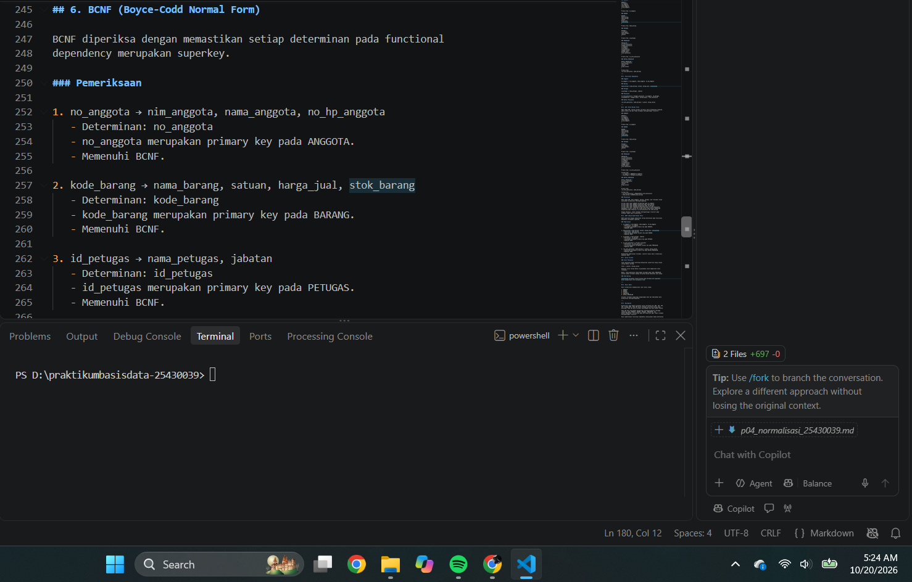

**Screenshot SS40**

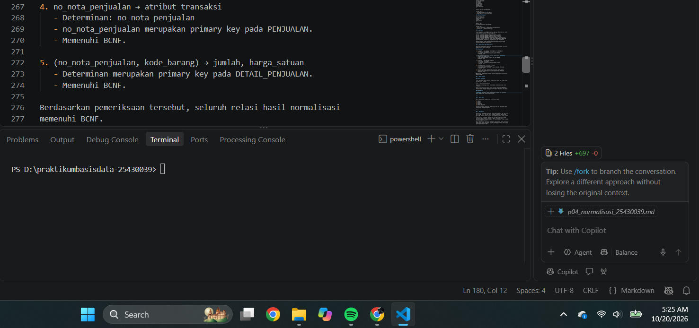

---

# BAB VII
## NILAI TURUNAN

### 7.1 Pengertian Nilai Turunan

Nilai turunan adalah nilai yang dapat dihitung berdasarkan atribut lain.

Pada transaksi penjualan, total dapat dihitung berdasarkan jumlah barang dan harga satuan.

Rumus:

```text
subtotal = jumlah × harga_satuan
```

Sedangkan total transaksi dapat diperoleh dari penjumlahan seluruh subtotal detail transaksi.

```text
total_penjualan = Σ(jumlah × harga_satuan)
```

### 7.2 Manfaat Nilai Turunan

Nilai turunan tidak selalu harus disimpan sebagai kolom permanen karena dapat dihitung ketika diperlukan. Hal tersebut dapat membantu mengurangi kemungkinan ketidaksesuaian data akibat nilai hasil perhitungan yang tidak diperbarui.

### 7.3 Dokumentasi Nilai Turunan

**Screenshot SS41**

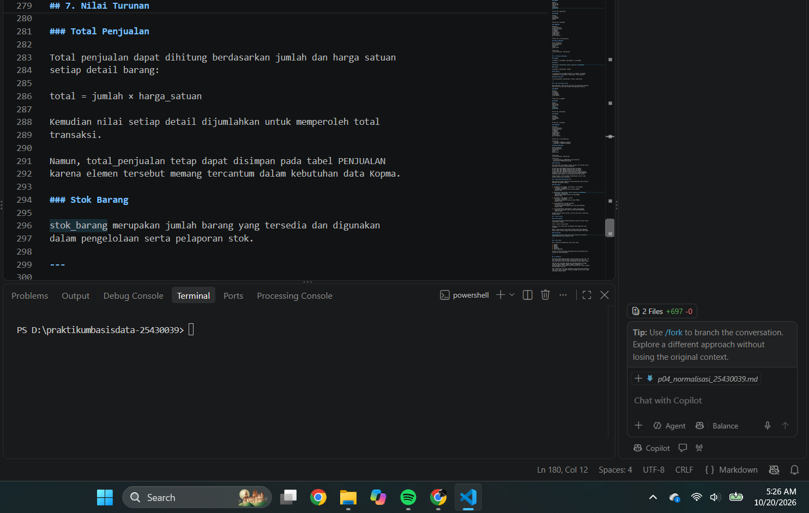

---

# BAB VIII
## HASIL AKHIR SKEMA RELASIONAL

Hasil proses normalisasi menghasilkan struktur database yang lebih terorganisasi. Data master dipisahkan dari data transaksi sehingga tidak terjadi pengulangan informasi yang tidak diperlukan.

Relasi utama yang terbentuk adalah:

```text
PETUGAS
    |
    | 1 : N
    v
PENJUALAN
    |
    | 1 : N
    v
DETAIL_PENJUALAN
    ^
    |
    | N : 1
    |
BARANG

ANGGOTA
    |
    | 1 : N
    v
PENJUALAN
```

Struktur tersebut memungkinkan data transaksi memiliki hubungan dengan anggota, petugas, dan barang tanpa harus menyimpan informasi yang sama berulang kali.

---

# BAB IX
## ANALISIS

### 9.1 Analisis UNF

Pada bentuk UNF, terdapat repeating group berupa informasi barang. Kondisi tersebut menyebabkan satu transaksi dapat menyimpan beberapa kelompok data barang dalam satu struktur.

### 9.2 Analisis 1NF

Pada 1NF, repeating group dihilangkan sehingga setiap nilai menjadi atomik. Setiap detail barang ditempatkan pada baris tersendiri.

### 9.3 Analisis 2NF

Pada 2NF, atribut yang hanya bergantung pada sebagian primary key dipisahkan. Informasi barang, anggota, dan petugas tidak lagi dicampur dengan detail transaksi.

### 9.4 Analisis 3NF

Pada 3NF, ketergantungan transitif dihilangkan. Informasi yang bergantung pada atribut non-key dipindahkan ke tabel master masing-masing.

### 9.5 Manfaat Normalisasi

Normalisasi memberikan beberapa manfaat:

1. Mengurangi redundansi data.
2. Mengurangi kemungkinan inkonsistensi.
3. Mempermudah proses update.
4. Mempermudah proses pemeliharaan database.
5. Membuat hubungan antar data lebih jelas.
6. Mempermudah pengembangan sistem.

---

# BAB X
## KESIMPULAN

Berdasarkan praktikum Modul 4, dapat disimpulkan bahwa normalisasi merupakan proses penting dalam perancangan database untuk menghasilkan struktur data yang terorganisasi dan mengurangi redundansi.

Data transaksi yang awalnya berada dalam bentuk UNF memiliki repeating group sehingga perlu dilakukan normalisasi. Setelah melalui 1NF, 2NF, dan 3NF, data dapat dipisahkan menjadi tabel-tabel berdasarkan fungsi dan ketergantungan atribut.

Analisis functional dependency membantu menentukan atribut yang harus ditempatkan pada tabel tertentu. Nilai turunan juga dapat diidentifikasi sehingga perhitungan seperti total transaksi dapat diperoleh dari data detail.

Dengan hasil normalisasi tersebut, skema relasional menjadi lebih terstruktur dan siap digunakan sebagai dasar pembuatan database.

---

# PERNYATAAN PENGGUNAAN AI

Dalam penyusunan laporan Praktikum Basis Data Modul 4 ini, saya menggunakan bantuan **Artificial Intelligence (AI)** sebagai alat bantu untuk memahami materi, menyusun struktur laporan, menjelaskan konsep normalisasi, functional dependency, 1NF, 2NF, 3NF, serta membantu merapikan penulisan laporan.

Penggunaan AI tidak menggantikan proses praktikum yang dilakukan secara langsung. Seluruh proses pengerjaan, analisis data, proses normalisasi, pembuatan skema relasional, serta pengambilan screenshot dilakukan berdasarkan hasil praktikum yang telah dikerjakan.

Saya bertanggung jawab untuk memeriksa kembali isi laporan, hasil normalisasi, struktur tabel, dan dokumentasi screenshot sebelum laporan dikumpulkan.