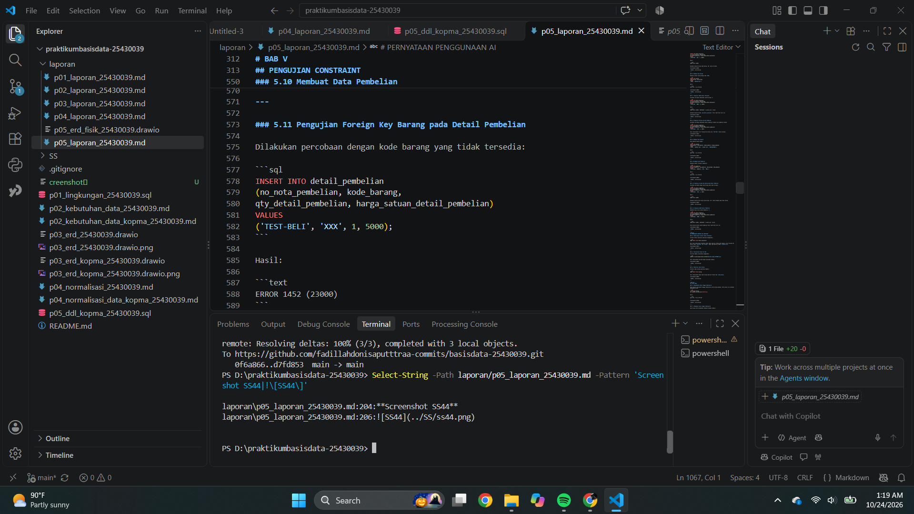
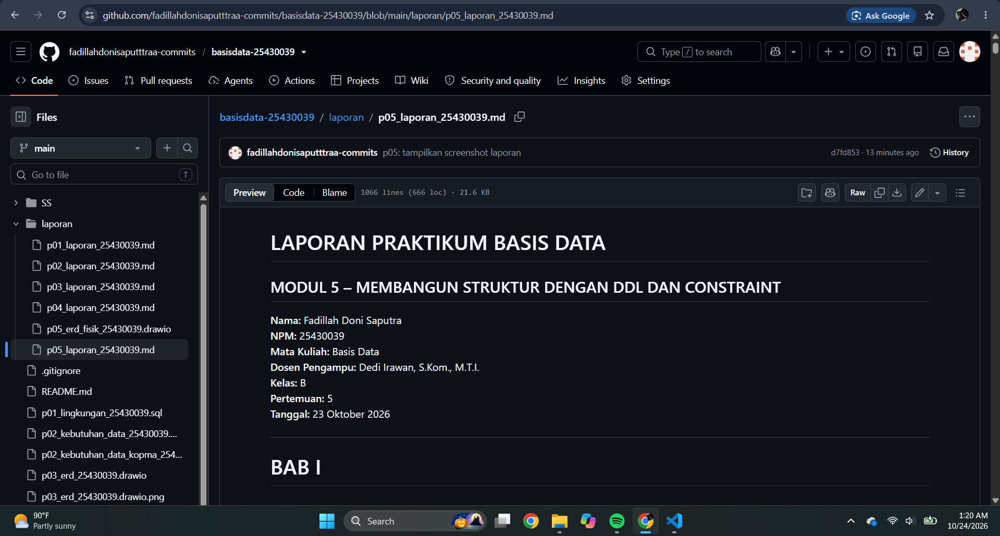

# LAPORAN PRAKTIKUM BASIS DATA

## MODUL 5 – DDL (DATA DEFINITION LANGUAGE) DAN CONSTRAINT

**Nama:** Fadillah Doni Saputra  
**NPM:** 25430039  
**Mata Kuliah:** Basis Data  
**Dosen Pengampu:** Dedi Irawan, S.Kom., M.T.I.  
**Kelas:** B  
**Pertemuan:** 5  
**Tanggal:** 23 Oktober 2026  

---

# BAB I  
## PENDAHULUAN

### 1.1 Latar Belakang

Basis data merupakan bagian penting dalam pembangunan sistem informasi karena data perlu disimpan secara terstruktur, konsisten, dan mudah dikelola. Dalam pengelolaan basis data, struktur tabel harus dibuat sesuai kebutuhan serta memiliki aturan yang dapat menjaga agar data tetap valid.

Pada praktikum Modul 5 dilakukan penerapan **Data Definition Language (DDL)** pada database Kopma menggunakan MariaDB. DDL digunakan untuk membuat serta mengubah struktur tabel. Selain itu, diterapkan berbagai constraint seperti **PRIMARY KEY, FOREIGN KEY, UNIQUE, NOT NULL, DEFAULT, dan CHECK**.

Pada praktikum ini juga dilakukan pengujian terhadap constraint dengan memasukkan data yang tidak sesuai. Pengujian tersebut bertujuan untuk mengetahui bagaimana MariaDB mencegah data yang melanggar aturan. Selain itu dilakukan pemeriksaan struktur tabel, pembuatan ERD fisik, pemeriksaan menggunakan phpMyAdmin Designer, perubahan struktur tabel menggunakan ALTER TABLE, serta dokumentasi menggunakan Git dan GitHub.

### 1.2 Tujuan Praktikum

1. Memahami penggunaan DDL pada MariaDB.
2. Membuat struktur tabel database Kopma.
3. Menerapkan PRIMARY KEY dan UNIQUE.
4. Menerapkan FOREIGN KEY.
5. Menerapkan NOT NULL dan DEFAULT.
6. Menerapkan CHECK untuk membatasi nilai data.
7. Menguji constraint menggunakan data yang tidak valid.
8. Mengubah struktur tabel menggunakan ALTER TABLE.
9. Membuat dan memeriksa ERD fisik.
10. Mendokumentasikan hasil praktikum menggunakan Git dan GitHub.

---

# BAB II  
## DASAR TEORI

### 2.1 Data Definition Language

Data Definition Language atau DDL merupakan bagian dari SQL yang digunakan untuk mendefinisikan struktur database. Beberapa perintah DDL yang digunakan dalam praktikum adalah `CREATE TABLE`, `ALTER TABLE`, dan `DROP TABLE`.

### 2.2 PRIMARY KEY

PRIMARY KEY digunakan sebagai identitas unik dari setiap record dalam tabel. Nilai PRIMARY KEY tidak boleh sama dan tidak boleh bernilai NULL.

### 2.3 FOREIGN KEY

FOREIGN KEY digunakan untuk menghubungkan suatu tabel dengan tabel lainnya. Nilai pada foreign key harus memiliki data pasangan pada tabel induk sesuai aturan relasi.

### 2.4 UNIQUE

UNIQUE digunakan untuk memastikan nilai dalam suatu kolom tidak boleh memiliki duplikasi.

### 2.5 NOT NULL

NOT NULL digunakan untuk menentukan bahwa sebuah kolom wajib memiliki nilai.

### 2.6 DEFAULT

DEFAULT digunakan untuk memberikan nilai otomatis apabila nilai suatu kolom tidak diberikan ketika proses INSERT.

### 2.7 CHECK

CHECK digunakan untuk membatasi nilai berdasarkan kondisi tertentu. Contohnya quantity tidak boleh bernilai nol atau negatif.

---

# BAB III  
## DATABASE KOPMA

### 3.1 Nama Database

Database yang digunakan pada praktikum adalah:

```sql
kopma_039
```

### 3.2 Tabel Database

Database Kopma terdiri dari delapan tabel, yaitu:

| No | Nama Tabel | Keterangan |
|---:|---|---|
| 1 | petugas | Menyimpan data petugas |
| 2 | anggota | Menyimpan data anggota |
| 3 | barang | Menyimpan data barang |
| 4 | pemasok | Menyimpan data pemasok |
| 5 | penjualan | Menyimpan data transaksi penjualan |
| 6 | detail_penjualan | Menyimpan detail transaksi penjualan |
| 7 | pembelian | Menyimpan data transaksi pembelian |
| 8 | detail_pembelian | Menyimpan detail transaksi pembelian |

---

# BAB IV  
## LANGKAH PRAKTIKUM

### 4.1 Pemeriksaan Struktur Tabel Petugas

Perintah yang digunakan:

```sql
SHOW CREATE TABLE petugas;
```

Perintah tersebut digunakan untuk melihat struktur tabel `petugas`, termasuk kolom, primary key, dan constraint yang terdapat pada tabel.

**Screenshot SS44**


---

### 4.2 Pemeriksaan Struktur Tabel Anggota

Perintah:

```sql
SHOW CREATE TABLE anggota;
```

Perintah digunakan untuk melihat struktur tabel anggota dan constraint yang diterapkan.

**Screenshot SS45**


---

### 4.3 Pemeriksaan Struktur Tabel Barang

Perintah:

```sql
SHOW CREATE TABLE barang;
```

Struktur tabel barang digunakan untuk menyimpan informasi barang yang digunakan dalam transaksi Kopma.

**Screenshot SS46**


---

### 4.4 Pemeriksaan Struktur Tabel Pemasok

Perintah:

```sql
SHOW CREATE TABLE pemasok;
```

Perintah digunakan untuk melihat struktur tabel pemasok.

**Screenshot SS47**


---

### 4.5 Pemeriksaan Struktur Tabel Penjualan

Perintah:

```sql
SHOW CREATE TABLE penjualan;
```

Tabel penjualan digunakan untuk menyimpan informasi transaksi penjualan.

**Screenshot SS48**


---

### 4.6 Pemeriksaan Struktur Detail Penjualan

Perintah:

```sql
SHOW CREATE TABLE detail_penjualan;
```

Tabel detail penjualan digunakan untuk menyimpan rincian barang pada setiap transaksi penjualan.

**Screenshot SS49**


---

### 4.7 Pemeriksaan Struktur Tabel Pembelian

Perintah:

```sql
SHOW CREATE TABLE pembelian;
```

Tabel pembelian digunakan untuk menyimpan data transaksi pembelian.

**Screenshot SS50**


---

### 4.8 Pemeriksaan Struktur Detail Pembelian

Perintah:

```sql
SHOW CREATE TABLE detail_pembelian;
```

Tabel detail pembelian digunakan untuk menyimpan rincian barang pada transaksi pembelian.

**Screenshot SS51**


---

# BAB V  
## PENGUJIAN CONSTRAINT

### 5.1 Pengujian FOREIGN KEY Petugas

Dilakukan pengujian dengan memasukkan data transaksi yang mengacu pada petugas yang tidak tersedia pada tabel induk.

**Screenshot SS52**


Hasil pengujian menunjukkan **ERROR 1452**. Error tersebut terjadi karena nilai foreign key tidak mempunyai pasangan pada tabel induk.

---

### 5.2 Pengujian Duplikasi Kode Petugas

Dilakukan percobaan memasukkan kode petugas `K01` yang sudah digunakan.

**Screenshot SS53**


Hasil pengujian menunjukkan **ERROR 1062**, sehingga database menolak data karena terjadi duplikasi nilai yang bersifat unik.

---

### 5.3 Pengujian CHECK Stok Barang

Dilakukan percobaan memasukkan nilai stok yang tidak memenuhi aturan CHECK.

**Screenshot SS54**


Hasil menunjukkan **ERROR 4025** karena nilai yang dimasukkan melanggar constraint CHECK pada stok barang.

---

### 5.4 Pengujian CHECK Harga Barang

Dilakukan percobaan memasukkan harga barang dengan nilai yang tidak valid.

**Screenshot SS55**


Hasil menunjukkan **ERROR 4025** karena data melanggar constraint CHECK harga barang.

---

### 5.5 Melihat Seluruh Tabel

Perintah:

```sql
SHOW TABLES;
```

digunakan untuk melihat seluruh tabel yang terdapat pada database `kopma_039`.

**Screenshot SS56**


Hasil menunjukkan terdapat **8 tabel** pada database.

---

# BAB VI  
## ERD DAN DESIGNER

### 6.1 ERD Fisik

ERD fisik dibuat untuk menggambarkan tabel beserta hubungan antar tabel pada database Kopma. ERD memperlihatkan primary key, foreign key, serta hubungan antar entitas.

**Screenshot SS57**


---

### 6.2 phpMyAdmin Designer

phpMyAdmin Designer digunakan untuk melihat hubungan antar tabel secara visual berdasarkan struktur database yang telah dibuat.

**Screenshot SS58**


---

# BAB VII  
## PEMERIKSAAN STRUKTUR DATABASE

### 7.1 Eksekusi DDL dan Pemeriksaan Tabel

File DDL dijalankan kemudian struktur database diperiksa menggunakan perintah:

```sql
SHOW TABLES;
```

**Screenshot SS59**


---

### 7.2 Pemeriksaan Struktur Petugas

Dilakukan pemeriksaan kembali terhadap struktur tabel petugas menggunakan `SHOW CREATE TABLE`.

**Screenshot SS60**


---

### 7.3 Pemeriksaan Petugas dan Anggota

Pemeriksaan dilanjutkan pada tabel petugas dan anggota.

**Screenshot SS61**


---

### 7.4 Pemeriksaan Anggota dan Barang

Dilakukan pemeriksaan struktur tabel anggota dan barang.

**Screenshot SS62**


---

### 7.5 Pemeriksaan Barang dan Pemasok

Dilakukan pemeriksaan struktur tabel barang dan pemasok.

**Screenshot SS63**


---

### 7.6 Pemeriksaan Pemasok dan Penjualan

Dilakukan pemeriksaan struktur tabel pemasok dan penjualan.

**Screenshot SS64**


---

### 7.7 Pemeriksaan Detail Penjualan

Dilakukan pemeriksaan struktur tabel `detail_penjualan`.

**Screenshot SS65**


---

### 7.8 Pemeriksaan Pembelian

Dilakukan pemeriksaan struktur tabel `pembelian`.

**Screenshot SS66**


---

### 7.9 Pemeriksaan Detail Pembelian

Dilakukan pemeriksaan struktur tabel `detail_pembelian`.

**Screenshot SS67**


---

# BAB VIII  
## PENGUJIAN FOREIGN KEY DAN CHECK

### 8.1 Pengujian Kode Petugas

Pengujian dilakukan terhadap kode petugas untuk memastikan constraint yang diterapkan dapat mencegah data yang tidak valid dan duplikasi.

**Screenshot SS68**


**Screenshot SS69**


---

### 8.2 Pengujian Relasi Petugas dan Anggota

Dilakukan pengujian terhadap hubungan antara data petugas dan anggota.

**Screenshot SS70**


---

### 8.3 Pengujian FOREIGN KEY Barang

Dilakukan pengujian pada detail penjualan menggunakan kode barang yang tidak terdapat pada tabel barang.

**Screenshot SS71**


Hasil menunjukkan database menolak data karena foreign key tidak memiliki pasangan pada tabel induk.

---

### 8.4 Pengujian FOREIGN KEY Pembelian

Dilakukan pengujian terhadap hubungan tabel pembelian, pemasok, dan detail pembelian.

**Screenshot SS72**


---

### 8.5 Pengujian CHECK Quantity

Pengujian dilakukan dengan memasukkan quantity yang tidak memenuhi aturan.

**Screenshot SS73**


**Screenshot SS74**


Hasil pengujian menunjukkan database menolak quantity yang tidak valid berdasarkan constraint CHECK.

---

# BAB IX  
## ALTER TABLE

### 9.1 Menambahkan Kolom Tanggal Kedaluwarsa

Dilakukan perubahan struktur tabel `barang` dengan menambahkan kolom:

```sql
ALTER TABLE barang
ADD COLUMN tgl_kedaluwarsa DATE NULL;
```

**Screenshot SS75**


Perintah berhasil dijalankan dan kolom `tgl_kedaluwarsa` berhasil ditambahkan.

---

### 9.2 Menghapus Kolom Tanggal Kedaluwarsa

Kolom yang telah ditambahkan kemudian dihapus menggunakan:

```sql
ALTER TABLE barang
DROP COLUMN tgl_kedaluwarsa;
```

**Screenshot SS76**


Perintah berhasil dijalankan.

---

### 9.3 Memeriksa Struktur Tabel Barang

Setelah kolom dihapus, struktur tabel diperiksa kembali:

```sql
SHOW CREATE TABLE barang;
```

**Screenshot SS77**


Hasil pemeriksaan menunjukkan kolom `tgl_kedaluwarsa` sudah tidak terdapat pada struktur tabel.

---

# BAB X  
## PENGUJIAN UNIQUE KODE BARANG

### 10.1 Menambahkan Data Barang

Dilakukan INSERT data barang dengan kode `B001`.

```sql
INSERT INTO barang
(kode_barang, nama_barang)
VALUES
('B001', 'Barang Duplikat');
```

Kemudian ditambahkan constraint UNIQUE:

```sql
ALTER TABLE barang
ADD CONSTRAINT uq_barang_kode UNIQUE (kode_barang);
```

---

### 10.2 Pengujian Data Duplikat

Setelah UNIQUE diterapkan, dilakukan percobaan memasukkan kembali kode barang `B001`.

**Screenshot SS78**


Hasil menunjukkan database menolak data karena kode `B001` telah digunakan.

---

### 10.3 Pemeriksaan Constraint UNIQUE

Struktur tabel barang diperiksa kembali menggunakan:

```sql
SHOW CREATE TABLE barang;
```

**Screenshot SS79**


Hasil menunjukkan adanya:

```text
UNIQUE KEY `uq_barang_kode` (`kode_barang`)
```

Dengan demikian constraint UNIQUE berhasil diterapkan pada `kode_barang`.

---

# BAB XI  
## BUKTI GIT DAN GITHUB

### 11.1 Bukti Git di VS Code

Setelah file praktikum selesai dibuat, dilakukan pemeriksaan repository menggunakan Git melalui terminal VS Code.

**Screenshot SS80**



Screenshot tersebut merupakan bukti aktivitas Git pada repository praktikum.

---

### 11.2 Bukti Repository GitHub

Repository GitHub digunakan untuk menyimpan hasil praktikum, file SQL, laporan, ERD, dan screenshot.

**Screenshot SS81**



Screenshot tersebut menunjukkan repository GitHub tempat hasil Modul 5 disimpan.

---

# BAB XII  
## ANALISIS

### 12.1 Analisis PRIMARY KEY

PRIMARY KEY berfungsi sebagai identitas unik setiap data. Dengan adanya PRIMARY KEY, database dapat mencegah adanya dua record dengan identitas yang sama.

### 12.2 Analisis FOREIGN KEY

FOREIGN KEY menjaga hubungan antar tabel agar tetap valid. Ketika data anak menggunakan nilai yang tidak tersedia pada tabel induk, MariaDB menolak proses tersebut.

Hal tersebut dibuktikan melalui pengujian yang menghasilkan ERROR 1452.

### 12.3 Analisis UNIQUE

UNIQUE mencegah adanya nilai yang sama pada kolom tertentu. Pada praktikum, `kode_barang` diberi constraint `uq_barang_kode`, sehingga kode barang `B001` tidak dapat dimasukkan dua kali.

### 12.4 Analisis CHECK

CHECK digunakan untuk memastikan nilai memenuhi kondisi yang ditentukan. Pengujian stok, harga, dan quantity membuktikan bahwa nilai yang melanggar aturan ditolak oleh database.

### 12.5 Analisis ALTER TABLE

ALTER TABLE memungkinkan struktur tabel diubah tanpa harus membuat tabel dari awal. Pada praktikum, kolom `tgl_kedaluwarsa` berhasil ditambahkan dan kemudian dihapus kembali.

### 12.6 Analisis ERD

ERD fisik membantu menggambarkan hubungan antar tabel. Dari ERD dapat diketahui tabel mana yang menjadi induk dan tabel mana yang menjadi anak berdasarkan hubungan primary key dan foreign key.

---

# BAB XIII  
## LATIHAN DAN MODIFIKASI

### 13.1 Penambahan CHECK Stok Minimum

Salah satu modifikasi yang dapat dilakukan adalah memberikan CHECK agar stok minimum tidak bernilai negatif.

```sql
ALTER TABLE barang
ADD CONSTRAINT ck_barang_stok_min
CHECK (stok_min_barang >= 0);
```

Constraint tersebut dapat membantu menjaga agar nilai stok minimum tetap valid.

### 13.2 ON DELETE CASCADE

ON DELETE CASCADE dapat digunakan pada relasi tertentu apabila penghapusan data induk memang harus menyebabkan data anak ikut terhapus.

Penggunaan cascade harus disesuaikan dengan kebutuhan sistem karena data transaksi biasanya perlu dipertahankan sebagai riwayat.

### 13.3 ON DELETE SET NULL

ON DELETE SET NULL dapat digunakan apabila data anak masih perlu dipertahankan ketika data induk dihapus. Kolom foreign key harus memungkinkan nilai NULL agar aturan tersebut dapat diterapkan.

---

# BAB XIV  
## KESIMPULAN

Berdasarkan praktikum Modul 5, dapat disimpulkan bahwa DDL digunakan untuk membangun dan mengubah struktur database Kopma. Database `kopma_039` berhasil memiliki delapan tabel dengan hubungan antar tabel yang dibentuk menggunakan primary key dan foreign key.

Penerapan constraint membantu menjaga integritas data. PRIMARY KEY dan UNIQUE mencegah duplikasi, FOREIGN KEY menjaga hubungan antar tabel, sedangkan CHECK membatasi nilai agar sesuai dengan aturan yang telah ditentukan.

Pengujian juga menunjukkan bahwa MariaDB memberikan pesan error ketika terdapat pelanggaran constraint, seperti ERROR 1062 untuk data duplikat, ERROR 1452 untuk foreign key yang tidak memiliki pasangan, dan ERROR 4025 untuk data yang melanggar CHECK.

Selain itu, penggunaan ALTER TABLE berhasil dilakukan untuk menambahkan dan menghapus kolom `tgl_kedaluwarsa`. ERD fisik dan phpMyAdmin Designer membantu dalam memvisualisasikan hubungan antar tabel.

Seluruh hasil praktikum kemudian didokumentasikan menggunakan Git dan disimpan pada repository GitHub.

---

# PERNYATAAN PENGGUNAAN AI

Dalam penyusunan laporan Praktikum Basis Data Modul 5 ini, saya menggunakan bantuan Artificial Intelligence (AI) sebagai alat bantu untuk memahami materi, menyusun struktur laporan, menjelaskan konsep DDL dan constraint, serta membantu merapikan penulisan.

Penggunaan AI tidak menggantikan proses praktikum yang dilakukan secara langsung. Proses pembuatan database, eksekusi perintah SQL, pengujian constraint, pemeriksaan struktur tabel, pembuatan ERD, penggunaan phpMyAdmin Designer, serta proses Git dan GitHub dilakukan berdasarkan hasil praktikum yang telah dikerjakan.

Saya bertanggung jawab untuk memeriksa kembali isi laporan, perintah SQL, hasil pengujian, dan screenshot sebelum laporan dikumpulkan.