# LAPORAN PRAKTIKUM BASIS DATA

## MODUL 5 – MEMBANGUN STRUKTUR DENGAN DDL DAN CONSTRAINT

**Nama:** Fadillah Doni Saputra  
**NPM:** 25430039  
**Mata Kuliah:** Basis Data  
**Dosen Pengampu:** Dedi Irawan, S.Kom., M.T.I.  
**Kelas:** B  
**Pertemuan:** 5  
**Tanggal:** 23 Oktober 2026  

---

# BAB I  
## PENDAHULUAN

### 1.1 Latar Belakang

Basis data merupakan salah satu komponen penting dalam pembangunan sistem informasi. Data yang disimpan dalam basis data harus memiliki struktur yang jelas serta aturan yang dapat menjaga konsistensi dan keamanannya. Oleh karena itu, selain membuat tabel, diperlukan aturan atau constraint yang dapat mencegah masuknya data yang tidak sesuai dengan kebutuhan sistem.

Pada praktikum Modul 5 dilakukan pembangunan struktur basis data Kopma menggunakan Data Definition Language (DDL) pada MariaDB. Rancangan database yang telah diperoleh dari proses normalisasi dan ERD kemudian diterapkan menjadi tabel-tabel yang dapat digunakan oleh sistem.

Dalam praktikum ini diterapkan beberapa constraint, yaitu PRIMARY KEY, FOREIGN KEY, UNIQUE, NOT NULL, DEFAULT, dan CHECK. Constraint tersebut digunakan untuk menjaga integritas data dan menerapkan aturan bisnis secara langsung pada database.

Selain membuat tabel, dilakukan pula pengujian dengan memasukkan data yang sengaja melanggar constraint. Pengujian tersebut menghasilkan beberapa error, seperti error 1062 karena data duplikat, error 1452 karena Foreign Key tidak memiliki data induk, dan error 4025 karena nilai tidak memenuhi aturan CHECK.

Praktikum juga mencakup perubahan struktur tabel menggunakan ALTER TABLE, pemeriksaan struktur dengan SHOW CREATE TABLE, pemeriksaan seluruh tabel menggunakan SHOW TABLES, serta perbandingan struktur fisik database dengan ERD melalui phpMyAdmin Designer.

---

### 1.2 Tujuan Praktikum

Tujuan dari praktikum Modul 5 adalah:

1. Menerjemahkan skema relasional 3NF menjadi perintah CREATE TABLE.
2. Menentukan tipe data yang sesuai untuk setiap atribut.
3. Menerapkan PRIMARY KEY pada setiap tabel.
4. Menerapkan FOREIGN KEY pada setiap relasi.
5. Menerapkan UNIQUE untuk mencegah data yang sama.
6. Menerapkan NOT NULL dan DEFAULT sesuai kebutuhan.
7. Menerapkan CHECK untuk menjaga aturan nilai data.
8. Menggunakan ALTER TABLE untuk mengubah struktur tabel.
9. Menguji constraint dengan data yang melanggar aturan.
10. Membandingkan database fisik dengan ERD menggunakan phpMyAdmin Designer.
11. Menyimpan dan mengunggah file DDL menggunakan Git dan GitHub.

---

# BAB II  
## DASAR TEORI

### 2.1 Data Definition Language (DDL)

Data Definition Language atau DDL merupakan bagian dari SQL yang digunakan untuk membuat, mengubah, dan menghapus struktur database.

Perintah DDL yang digunakan pada praktikum antara lain:

- `CREATE TABLE`
- `ALTER TABLE`
- `DROP TABLE`

DDL digunakan untuk membangun struktur tabel sebelum tabel tersebut diisi dengan data.

---

### 2.2 Tipe Data

Pemilihan tipe data harus disesuaikan dengan jenis data yang akan disimpan. Pemilihan tipe data yang tepat dapat menghemat ruang penyimpanan dan mencegah data yang tidak sesuai.

Beberapa tipe data yang digunakan pada rancangan Kopma antara lain:

| Tipe Data | Penggunaan |
|---|---|
| `CHAR` | Kode dengan panjang tetap |
| `VARCHAR` | Data teks dengan panjang bervariasi |
| `INT` | Bilangan bulat |
| `SMALLINT` | Bilangan bulat dengan rentang lebih kecil |
| `DECIMAL(12,2)` | Nilai uang |
| `DATE` | Tanggal |
| `DATETIME` | Tanggal dan waktu |
| `ENUM` | Data dengan pilihan nilai tertentu |

---

### 2.3 PRIMARY KEY

PRIMARY KEY digunakan sebagai identitas unik setiap baris dalam tabel. Nilai PRIMARY KEY tidak boleh sama dan tidak boleh NULL.

---

### 2.4 FOREIGN KEY

FOREIGN KEY digunakan untuk menghubungkan tabel anak dengan tabel induk. Nilai pada kolom Foreign Key harus mengacu pada data yang tersedia di tabel induk.

---

### 2.5 UNIQUE

UNIQUE digunakan untuk memastikan suatu nilai tidak boleh memiliki duplikat.

---

### 2.6 NOT NULL

NOT NULL digunakan untuk memastikan sebuah kolom wajib memiliki nilai.

---

### 2.7 DEFAULT

DEFAULT memberikan nilai otomatis apabila nilai untuk suatu kolom tidak diberikan.

---

### 2.8 CHECK

CHECK digunakan untuk memastikan nilai yang dimasukkan memenuhi kondisi tertentu.

Contohnya:

```sql
CHECK (qty_detail_penjualan > 0)
```

Artinya jumlah barang yang dijual harus lebih besar dari nol.

---

# BAB III  
## PERANCANGAN DATABASE KOPMA

### 3.1 Nama Database

Database yang digunakan pada praktikum adalah:

```text
kopma_039
```

Database menggunakan karakter:

```text
utf8mb4_unicode_ci
```

---

### 3.2 Tabel Database

Database Kopma terdiri dari delapan tabel:

| No | Nama Tabel | Fungsi |
|---|---|---|
| 1 | `petugas` | Menyimpan data petugas |
| 2 | `anggota` | Menyimpan data anggota |
| 3 | `barang` | Menyimpan data barang |
| 4 | `pemasok` | Menyimpan data pemasok |
| 5 | `penjualan` | Menyimpan kepala transaksi penjualan |
| 6 | `detail_penjualan` | Menyimpan rincian penjualan |
| 7 | `pembelian` | Menyimpan kepala transaksi pembelian |
| 8 | `detail_pembelian` | Menyimpan rincian pembelian |

---

### 3.3 Urutan Pembuatan Tabel

Pembuatan tabel dilakukan dari tabel induk menuju tabel anak:

```text
petugas
anggota
barang
pemasok
penjualan
detail_penjualan
pembelian
detail_pembelian
```

Sedangkan penghapusan tabel dilakukan secara terbalik agar tidak melanggar Foreign Key.

---

# BAB IV  
## LANGKAH PERCOBAAN

## 4.1 Menjalankan File DDL

File DDL yang dibuat adalah:

```text
p05_ddl_kopma_25430039.sql
```

File tersebut dijalankan pada MariaDB menggunakan perintah:

```sql
SOURCE D:/praktikumbasisdata-25430039/p05_ddl_kopma_25430039.sql;
```

Hasil eksekusi menunjukkan bahwa file berhasil dijalankan dan struktur database berhasil dibuat.

**Screenshot SS44**

```md
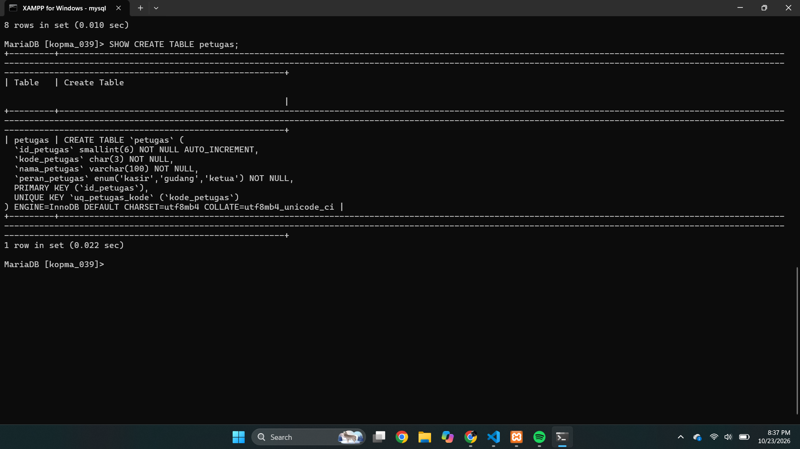
```

---

## 4.2 Memeriksa Seluruh Tabel

Untuk memastikan tabel berhasil dibuat digunakan perintah:

```sql
SHOW TABLES;
```

Hasilnya menunjukkan terdapat delapan tabel, yaitu `anggota`, `barang`, `detail_pembelian`, `detail_penjualan`, `pemasok`, `pembelian`, `penjualan`, dan `petugas`.

**Screenshot SS45**

```md
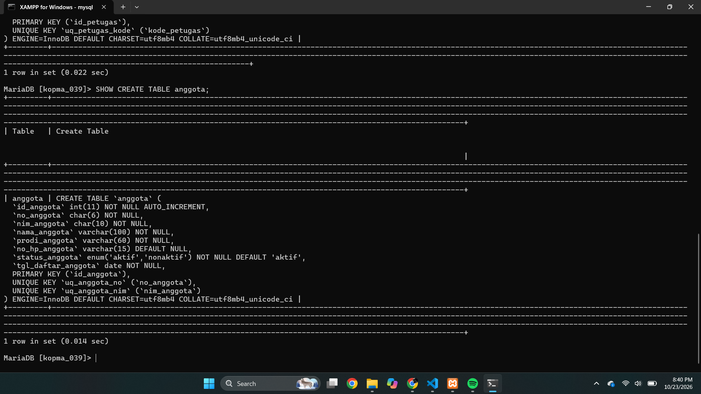
```

---

## 4.3 Pemeriksaan Struktur Tabel

Struktur tabel diperiksa menggunakan perintah:

```sql
SHOW CREATE TABLE petugas;
```

Perintah tersebut digunakan untuk melihat Primary Key, tipe data, serta constraint yang terdapat pada tabel petugas.

**Screenshot SS46**

```md
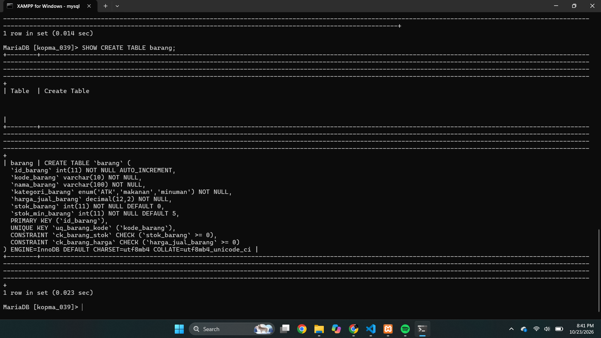
```

Selanjutnya dilakukan pemeriksaan tabel anggota:

```sql
SHOW CREATE TABLE anggota;
```

**Screenshot SS47**

```md
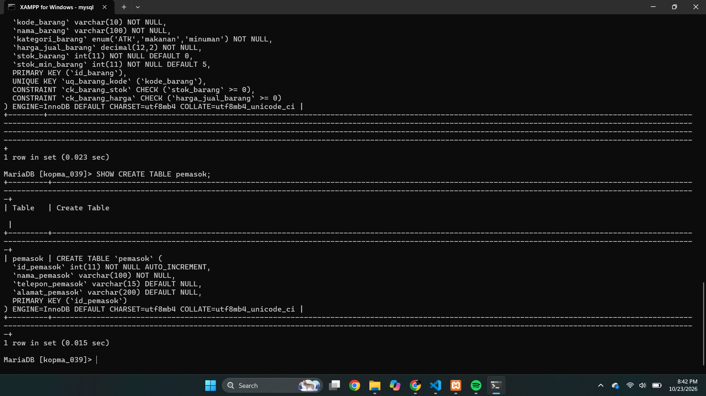
```

Pemeriksaan tabel barang:

```sql
SHOW CREATE TABLE barang;
```

**Screenshot SS48**

```md
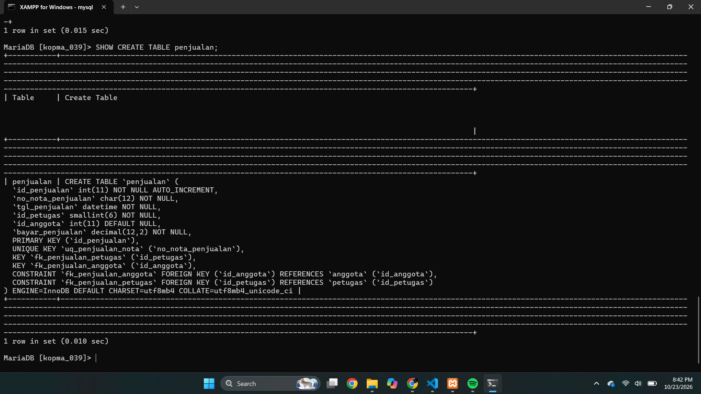
```

Pemeriksaan tabel pemasok:

```sql
SHOW CREATE TABLE pemasok;
```

**Screenshot SS49**

```md
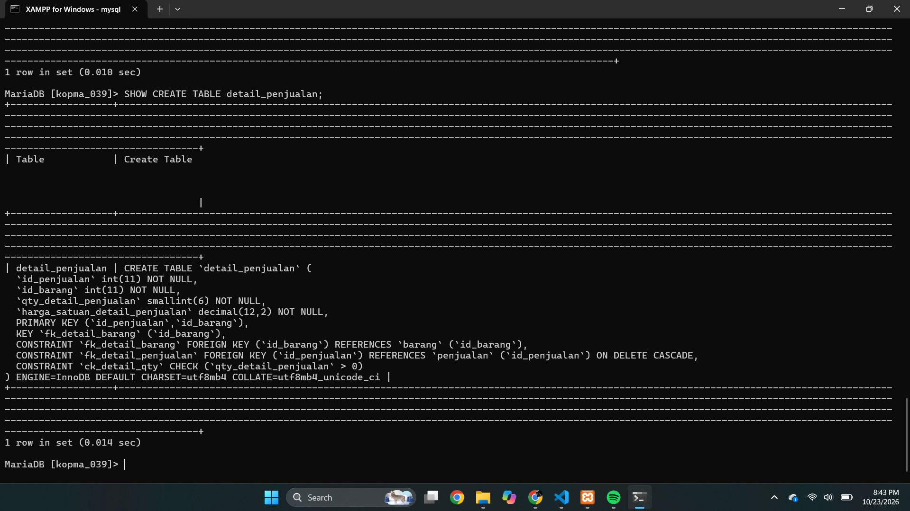
```

Pemeriksaan tabel penjualan:

```sql
SHOW CREATE TABLE penjualan;
```

**Screenshot SS50**

```md
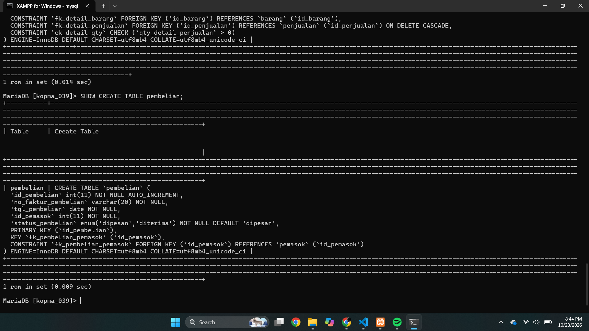
```

Pemeriksaan tabel detail penjualan:

```sql
SHOW CREATE TABLE detail_penjualan;
```

**Screenshot SS51**

```md
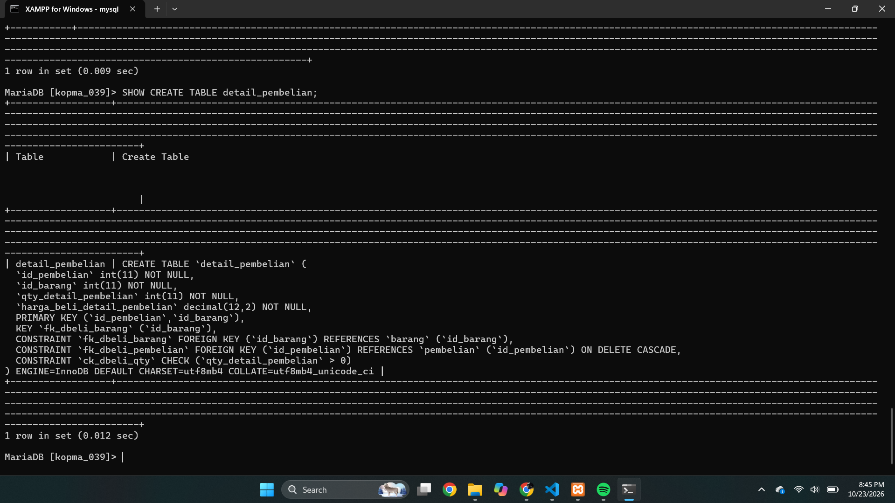
```

Pemeriksaan tabel pembelian:

```sql
SHOW CREATE TABLE pembelian;
```

**Screenshot SS52**

```md
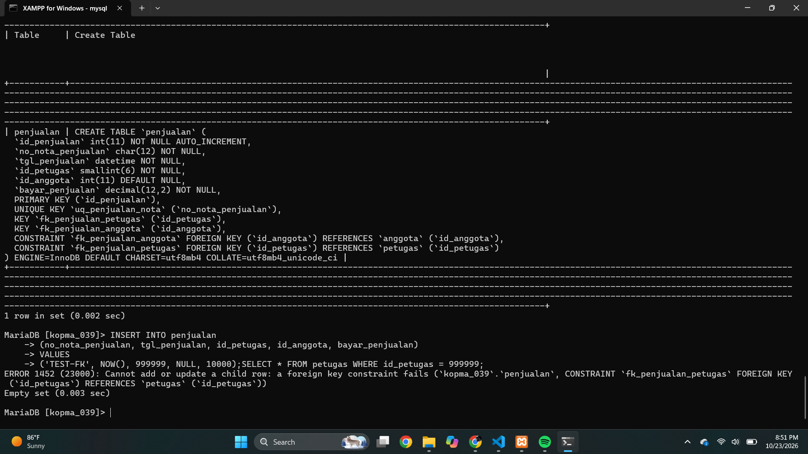
```

Pemeriksaan tabel detail pembelian:

```sql
SHOW CREATE TABLE detail_pembelian;
```

**Screenshot SS53**

```md
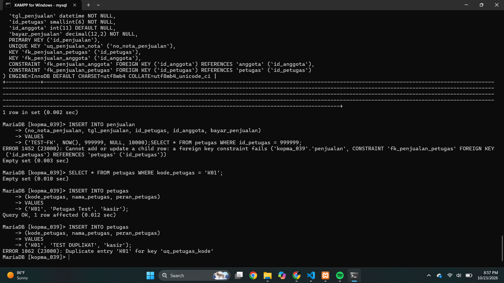
```

---

# BAB V  
## PENGUJIAN CONSTRAINT

### 5.1 Pengujian Primary Key

Dilakukan percobaan memasukkan data petugas dengan kode `K01` yang sudah digunakan.

```sql
INSERT INTO petugas
(kode_petugas, nama_petugas)
VALUES
('K01', 'TEST DUPLIKAT');
```

Hasil:

```text
ERROR 1062 (23000): Duplicate entry 'K01' for key 'PRIMARY'
```

Error tersebut menunjukkan bahwa database menolak data karena nilai Primary Key `K01` sudah ada.

**Screenshot SS54**

```md
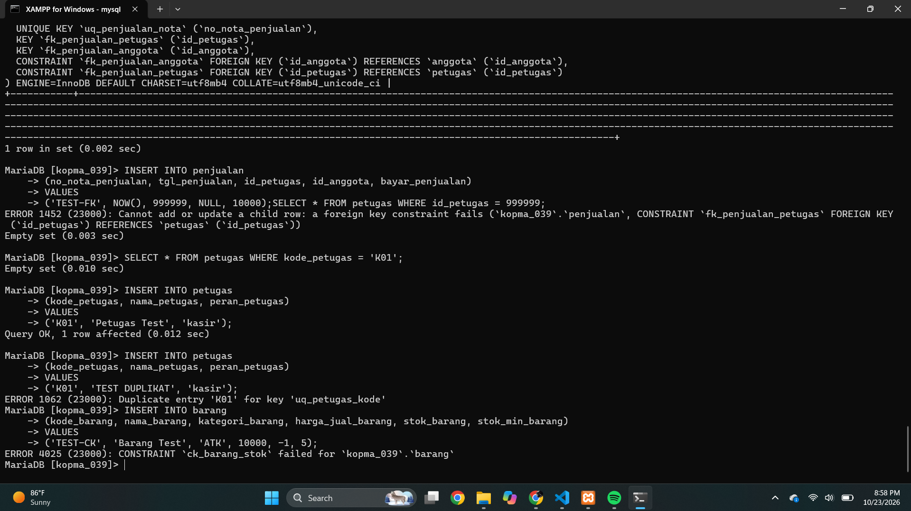
```

---

### 5.2 Pengujian Foreign Key Petugas

Dilakukan percobaan memasukkan transaksi penjualan dengan kode petugas yang tidak tersedia.

```sql
INSERT INTO penjualan
(no_nota_penjualan, tgl_penjualan, kode_petugas, no_anggota)
VALUES
('TEST-FK', CURDATE(), 'XXX', NULL);
```

Hasil:

```text
ERROR 1452 (23000)
```

Hal ini terjadi karena `XXX` tidak terdapat pada tabel petugas.

**Screenshot SS55**

```md
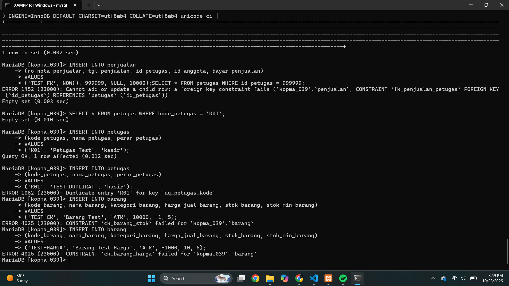
```

---

### 5.3 Pengujian Foreign Key Anggota

Dilakukan percobaan menggunakan nomor anggota yang belum tersedia:

```sql
INSERT INTO penjualan
(no_nota_penjualan, tgl_penjualan, kode_petugas, no_anggota)
VALUES
('TEST-FK2', CURDATE(), 'K01', 'XXX');
```

Hasil:

```text
ERROR 1452 (23000)
```

Database menolak transaksi karena `XXX` tidak ditemukan pada tabel anggota.

**Screenshot SS56**

```md
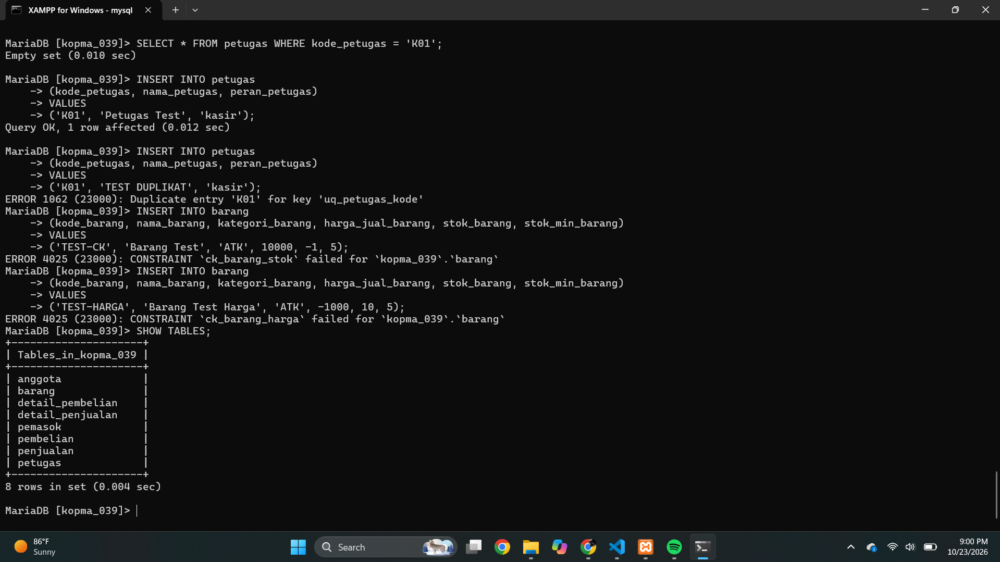
```

---

### 5.4 Membuat Data Anggota

Untuk melanjutkan pengujian, dibuat anggota dengan kode `A001`.

```sql
INSERT INTO anggota
(no_anggota, nama_anggota)
VALUES
('A001', 'Anggota Test');
```

Hasil:

```text
Query OK, 1 row affected
```

**Screenshot SS57**

```md
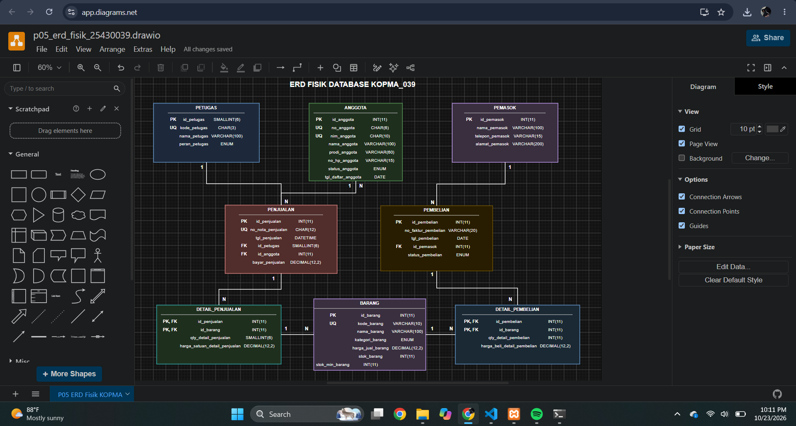
```

Kemudian dibuat transaksi penjualan:

```sql
INSERT INTO penjualan
(no_nota_penjualan, tgl_penjualan, kode_petugas, no_anggota)
VALUES
('TEST-FK2', CURDATE(), 'K01', 'A001');
```

Hasil:

```text
Query OK, 1 row affected
```

**Screenshot SS58**

```md
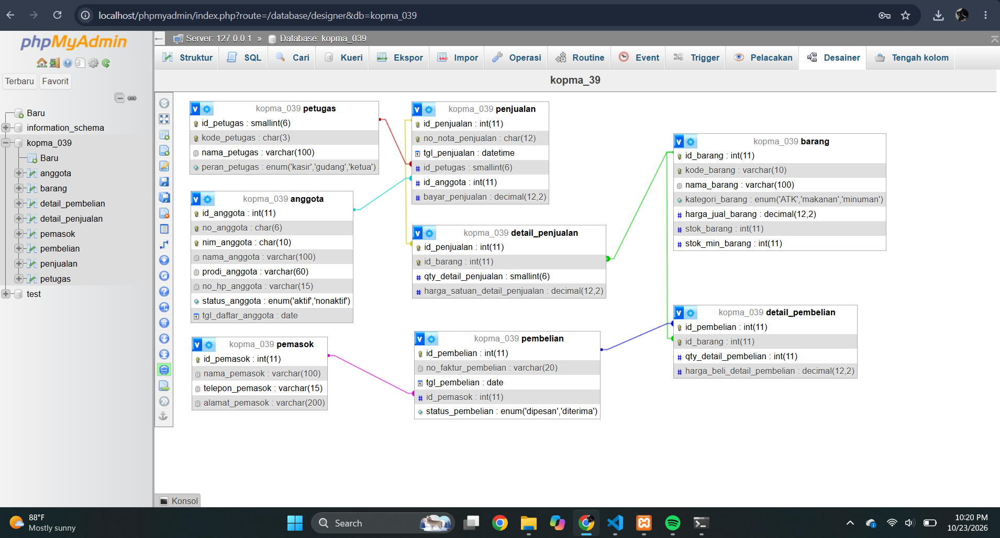
```

---

### 5.5 Pengujian Foreign Key Barang pada Detail Penjualan

Dilakukan percobaan memasukkan barang dengan kode `XXX`.

```sql
INSERT INTO detail_penjualan
(no_nota_penjualan, kode_barang,
qty_detail_penjualan, harga_satuan_detail_penjualan)
VALUES
('TEST-FK2', 'XXX', 1, 10000);
```

Hasil:

```text
ERROR 1452 (23000)
```

Database menolak karena kode barang `XXX` belum tersedia.

**Screenshot SS59**

```md
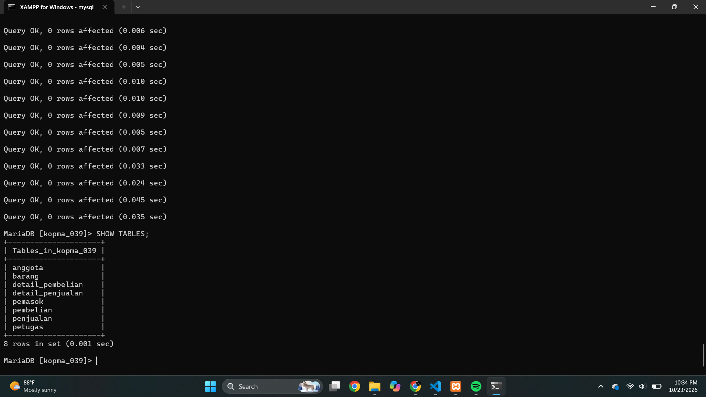
```

---

### 5.6 Membuat Data Barang

Kemudian dibuat barang dengan kode `B001`.

```sql
INSERT INTO barang
(kode_barang, nama_barang)
VALUES
('B001', 'Barang Test');
```

Hasil:

```text
Query OK, 1 row affected
```

**Screenshot SS60**

```md
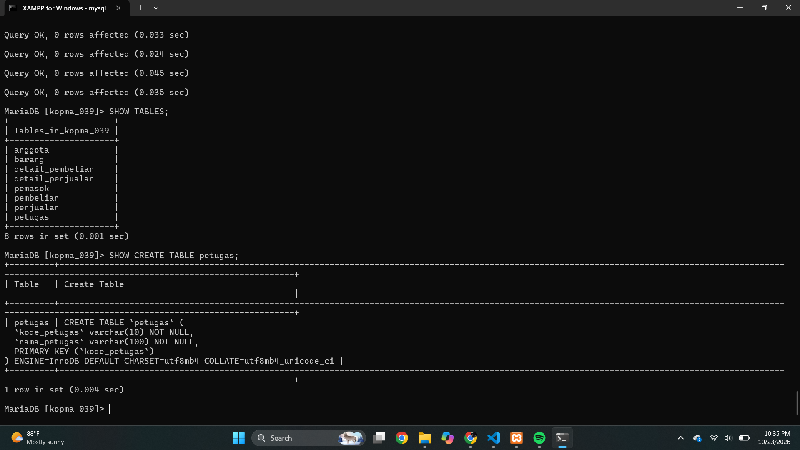
```

---

### 5.7 Pengujian CHECK Detail Penjualan

Dilakukan percobaan memasukkan jumlah barang `0`.

```sql
INSERT INTO detail_penjualan
(no_nota_penjualan, kode_barang,
qty_detail_penjualan, harga_satuan_detail_penjualan)
VALUES
('TEST-FK2', 'B001', 0, 10000);
```

Hasil:

```text
ERROR 4025 (23000): CONSTRAINT `ck_detail_qty` failed
```

Database menolak karena `qty_detail_penjualan` harus lebih besar dari nol.

**Screenshot SS61**

```md
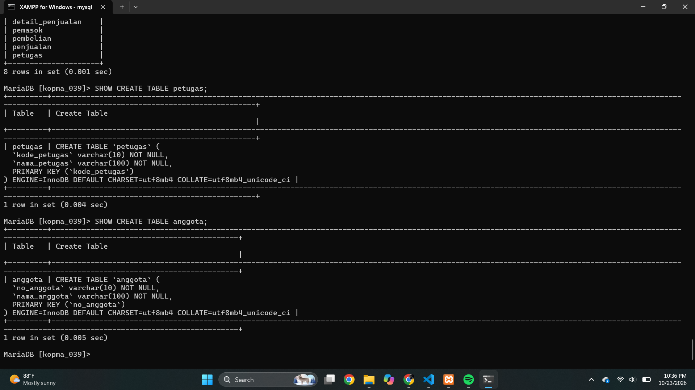
```

---

### 5.8 Pengujian Foreign Key Nota Pembelian

Dilakukan percobaan memasukkan detail pembelian sebelum nota pembelian dibuat.

```sql
INSERT INTO detail_pembelian
(no_nota_pembelian, kode_barang,
qty_detail_pembelian, harga_satuan_detail_pembelian)
VALUES
('TEST-BELI', 'XXX', 1, 5000);
```

Hasil menunjukkan error Foreign Key karena nota `TEST-BELI` belum tersedia.

**Screenshot SS62**

```md
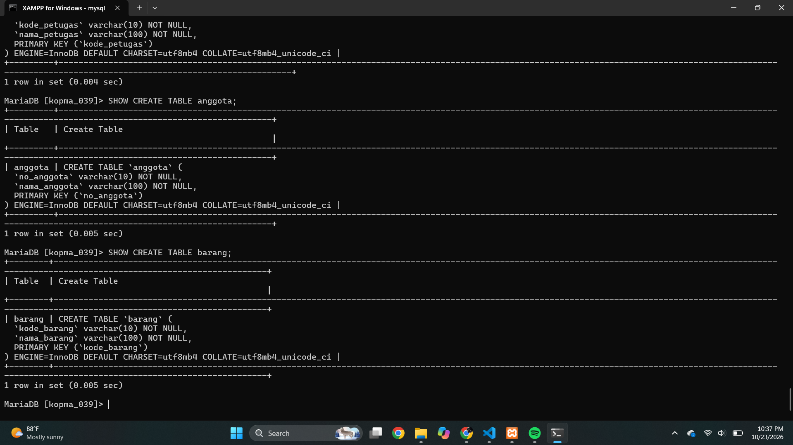
```

---

### 5.9 Membuat Data Pemasok

Data pemasok dibuat dengan:

```sql
INSERT INTO pemasok
(kode_pemasok, nama_pemasok, alamat_pemasok, telepon_pemasok)
VALUES
('P001', 'Pemasok Test', 'Alamat Test', '081234567890');
```

Hasil:

```text
Query OK, 1 row affected
```

**Screenshot SS63**

```md
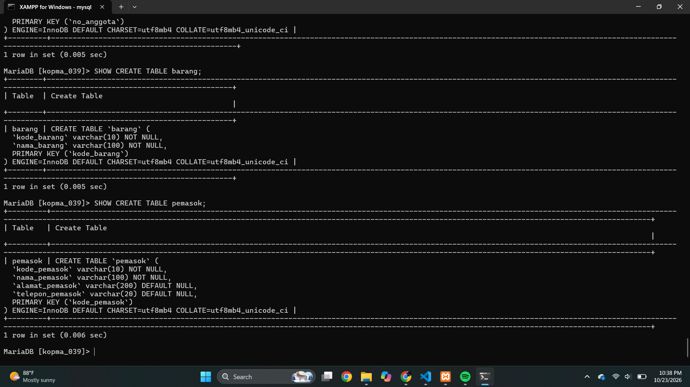
```

---

### 5.10 Membuat Data Pembelian

Kemudian dibuat transaksi pembelian:

```sql
INSERT INTO pembelian
(no_nota_pembelian, tgl_pembelian, kode_petugas, kode_pemasok)
VALUES
('TEST-BELI', CURDATE(), 'K01', 'P001');
```

Hasil:

```text
Query OK, 1 row affected
```

**Screenshot SS64**

```md
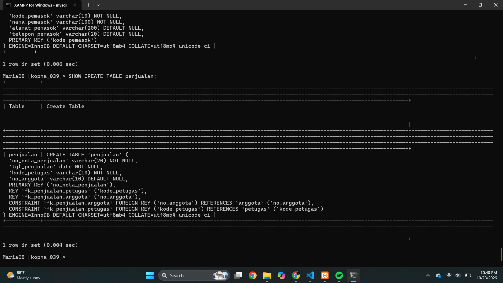
```

---

### 5.11 Pengujian Foreign Key Barang pada Detail Pembelian

Dilakukan percobaan dengan kode barang yang tidak tersedia:

```sql
INSERT INTO detail_pembelian
(no_nota_pembelian, kode_barang,
qty_detail_pembelian, harga_satuan_detail_pembelian)
VALUES
('TEST-BELI', 'XXX', 1, 5000);
```

Hasil:

```text
ERROR 1452 (23000)
```

Database menolak data karena kode barang `XXX` tidak terdapat pada tabel barang.

**Screenshot SS65**

```md
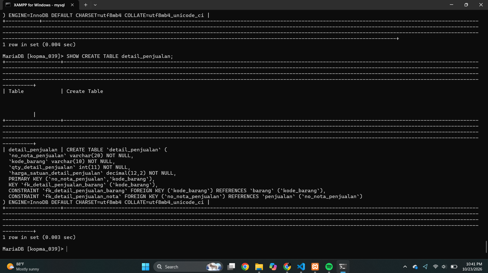
```

---

### 5.12 Pengujian CHECK Detail Pembelian

Kemudian diuji nilai jumlah pembelian `0`.

```sql
INSERT INTO detail_pembelian
(no_nota_pembelian, kode_barang,
qty_detail_pembelian, harga_satuan_detail_pembelian)
VALUES
('TEST-BELI', 'B001', 0, 5000);
```

Hasil:

```text
ERROR 4025 (23000): CONSTRAINT `ck_dbeli_qty` failed
```

Data ditolak karena jumlah pembelian harus lebih besar dari nol.

**Screenshot SS66**

```md
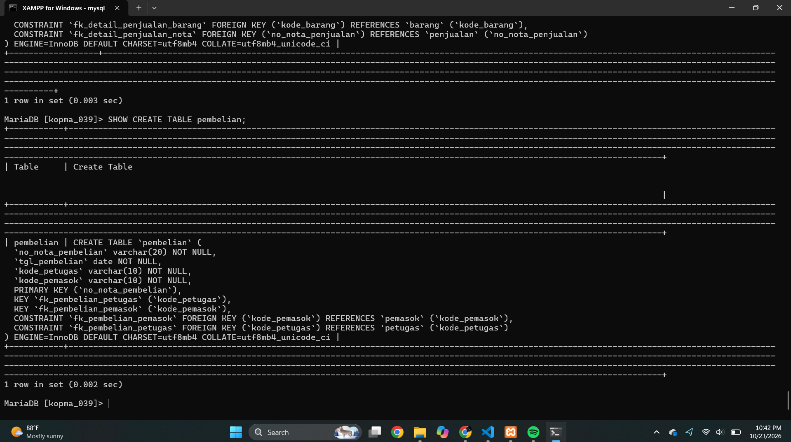
```

---

# BAB VI  
## PEMERIKSAAN STRUKTUR DAN CONSTRAINT

### 6.1 Pemeriksaan Struktur Detail Penjualan

Struktur detail penjualan diperiksa menggunakan:

```sql
SHOW CREATE TABLE detail_penjualan;
```

Dari hasil pemeriksaan diketahui bahwa tabel memiliki Primary Key komposit serta Foreign Key menuju tabel `penjualan` dan `barang`. Tabel juga memiliki CHECK `ck_detail_qty`.

**Screenshot SS67**

```md
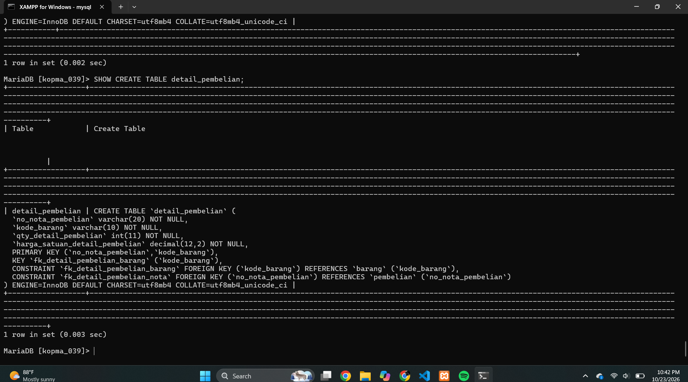
```

---

### 6.2 Menjalankan Ulang File DDL

File DDL kembali dijalankan menggunakan:

```sql
SOURCE D:/praktikumbasisdata-25430039/p05_ddl_kopma_25430039.sql;
```

Hasil menunjukkan perintah dapat dijalankan kembali.

**Screenshot SS68**

```md
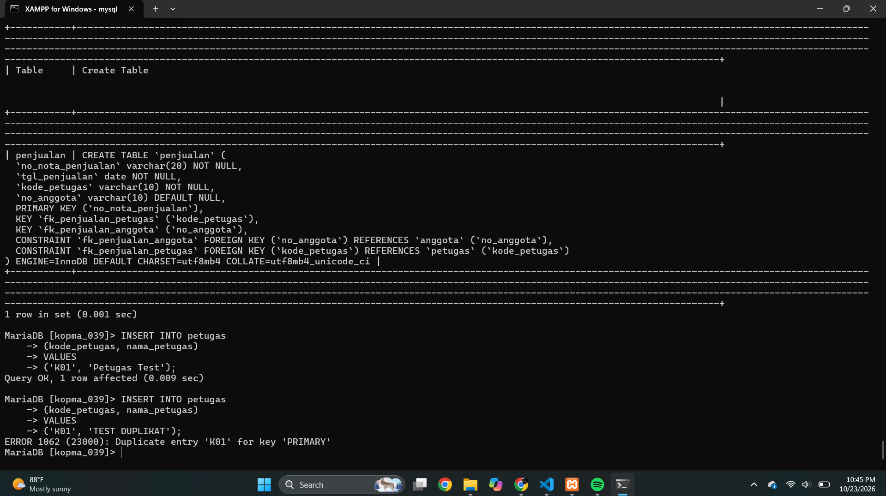
```

---

### 6.3 Memeriksa Tabel Barang

Struktur tabel barang diperiksa kembali:

```sql
SHOW CREATE TABLE barang;
```

Hasil menunjukkan bahwa tabel barang memiliki Primary Key `kode_barang`.

**Screenshot SS69**

```md
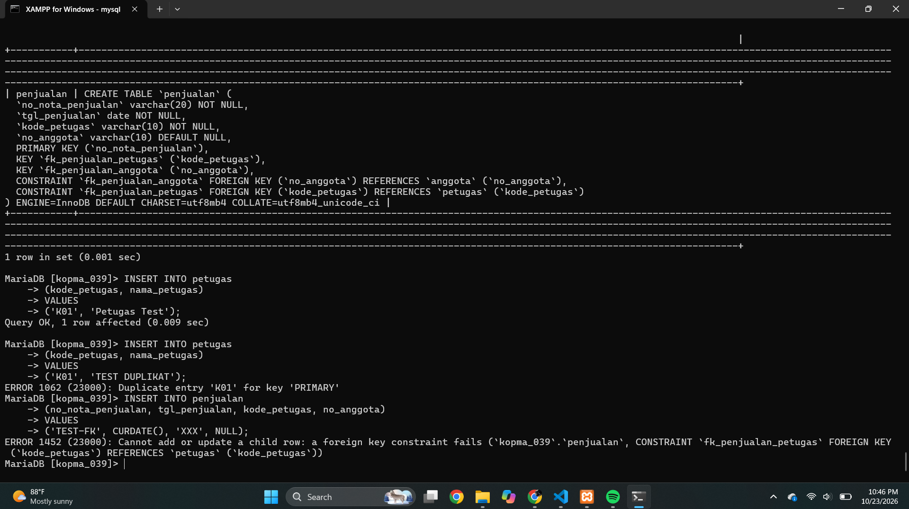
```

---

# BAB VII  
## ALTER TABLE

### 7.1 Menambahkan Kolom Tanggal Kedaluwarsa

Ketua meminta pencatatan tanggal kedaluwarsa untuk barang makanan. Oleh karena itu dilakukan penambahan kolom:

```sql
ALTER TABLE barang
ADD COLUMN tgl_kedaluwarsa DATE NULL;
```

Hasil:

```text
Query OK, 0 rows affected
```

**Screenshot SS70**

```md
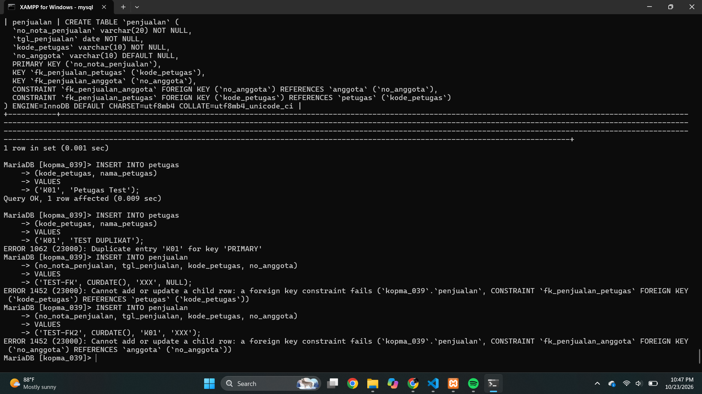
```

---

### 7.2 Menghapus Kolom Tanggal Kedaluwarsa

Kolom yang telah ditambahkan kemudian dihapus kembali:

```sql
ALTER TABLE barang
DROP COLUMN tgl_kedaluwarsa;
```

Hasil:

```text
Query OK, 0 rows affected
```

**Screenshot SS71**

```md
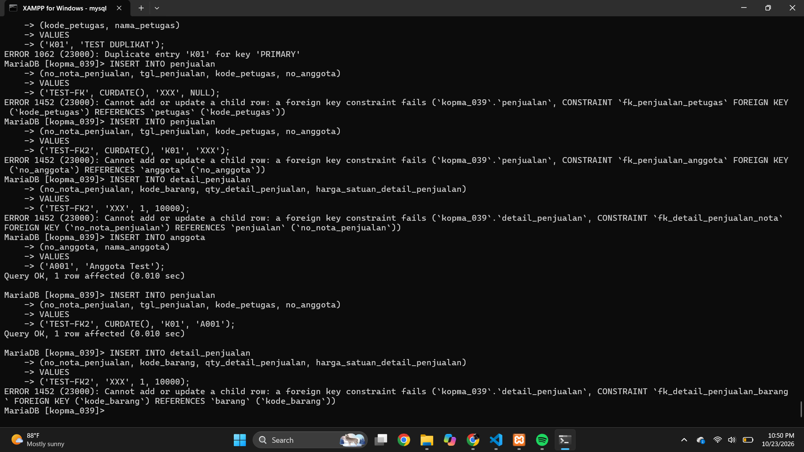
```

---

### 7.3 Memastikan Kolom Telah Dihapus

Struktur tabel diperiksa kembali menggunakan:

```sql
SHOW CREATE TABLE barang;
```

Hasil menunjukkan bahwa `tgl_kedaluwarsa` sudah tidak terdapat pada tabel.

**Screenshot SS72**

```md
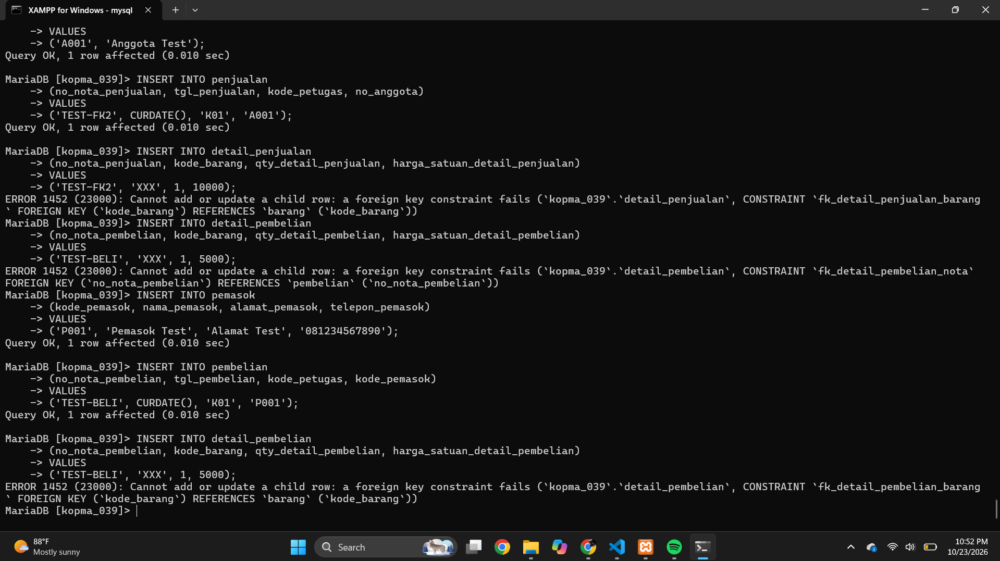
```

---

### 7.4 Menambahkan Constraint UNIQUE

Constraint UNIQUE pada `kode_barang` ditambahkan:

```sql
ALTER TABLE barang
ADD CONSTRAINT uq_barang_kode UNIQUE (kode_barang);
```

Perintah berhasil dijalankan.

**Screenshot SS73**

```md
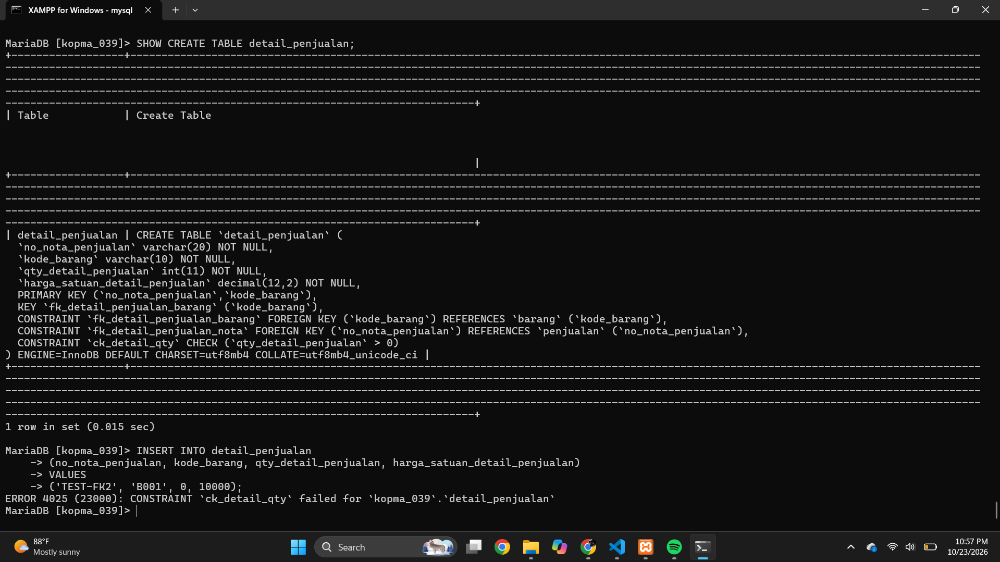
```

---

### 7.5 Memeriksa Constraint UNIQUE

Struktur tabel diperiksa kembali:

```sql
SHOW CREATE TABLE barang;
```

Hasil menunjukkan adanya:

```text
UNIQUE KEY `uq_barang_kode` (`kode_barang`)
```

**Screenshot SS74**

```md
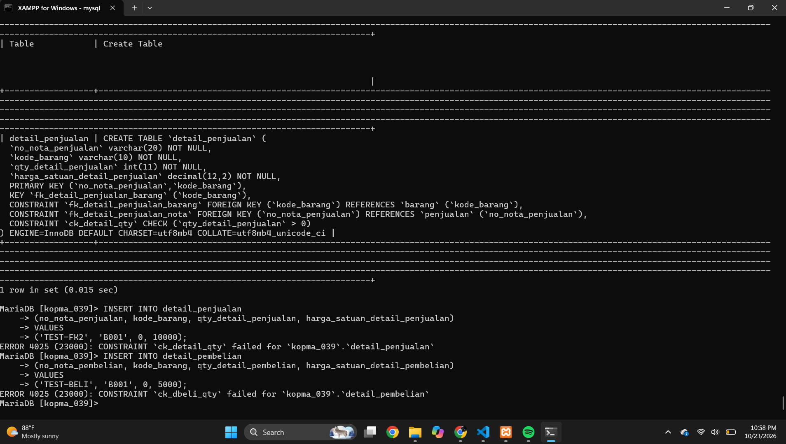
```

---

# BAB VIII  
## PEMERIKSAAN DATABASE

### 8.1 Memeriksa Seluruh Tabel

Perintah:

```sql
SHOW TABLES;
```

digunakan untuk memastikan seluruh tabel Kopma masih tersedia.

Hasil menunjukkan delapan tabel:

```text
anggota
barang
detail_pembelian
detail_penjualan
pemasok
pembelian
penjualan
petugas
```

**Screenshot SS75**

```md
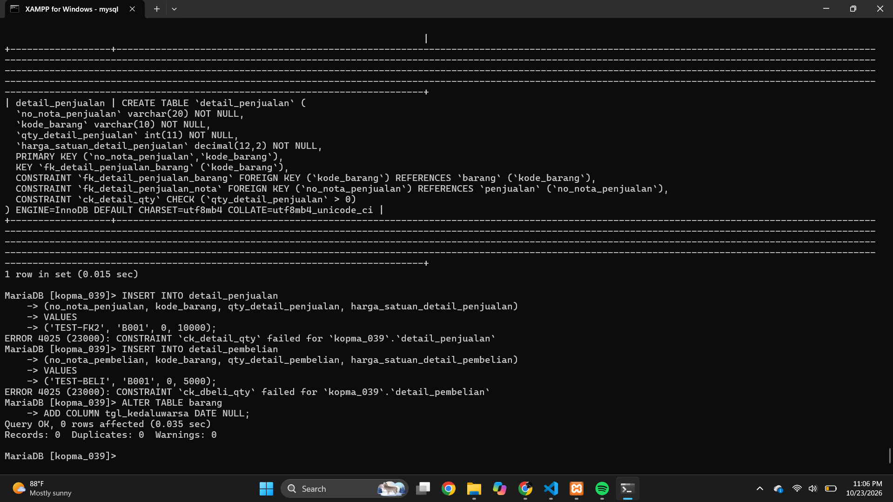
```

---

### 8.2 Pemeriksaan Detail Penjualan

Struktur `detail_penjualan` kembali diperiksa untuk memastikan constraint yang dibutuhkan telah tersedia.

**Screenshot SS76**

```md
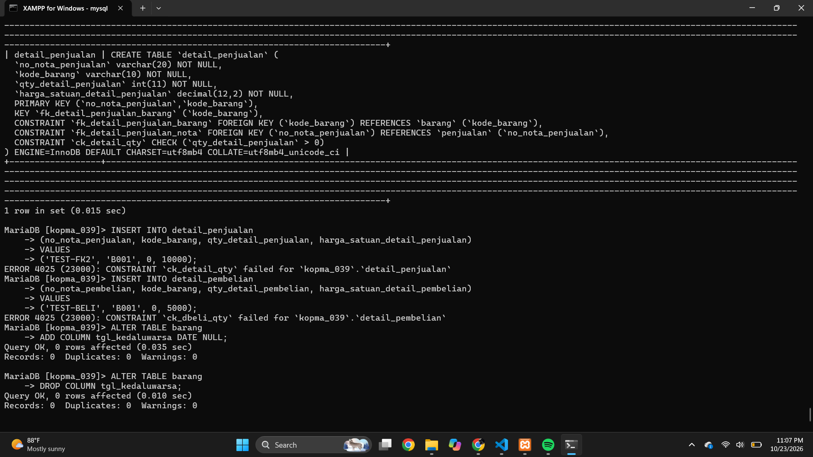
```

---

# BAB IX  
## PHPMyAdmin DESIGNER

### 9.1 Membuka Designer

Database `kopma_039` dibuka melalui phpMyAdmin dan menu **Designer** digunakan untuk melihat hubungan antar tabel.

Designer menampilkan hubungan antara tabel master, tabel transaksi, dan tabel detail.

**Screenshot SS77**

```md
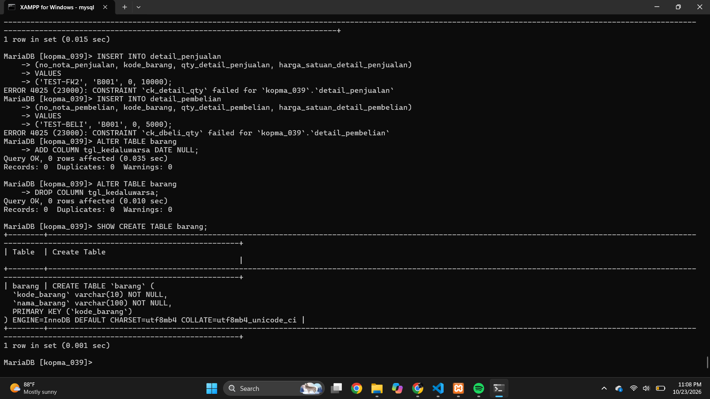
```

---

### 9.2 Membandingkan Designer dengan ERD

Struktur pada Designer dibandingkan dengan ERD yang telah dibuat pada pertemuan sebelumnya.

Relasi utama yang diperiksa adalah:

```text
petugas → penjualan
anggota → penjualan
penjualan → detail_penjualan
barang → detail_penjualan
petugas → pembelian
pemasok → pembelian
pembelian → detail_pembelian
barang → detail_pembelian
```

Perbandingan dilakukan untuk memastikan tabel dan hubungan pada database fisik sesuai dengan rancangan ERD.

---

# BAB X  
## GIT DAN GITHUB

### 10.1 Menambahkan File DDL

File DDL yang digunakan dalam proyek adalah:

```text
p05_ddl_kopma_25430039.sql
```

File kemudian ditambahkan ke Git menggunakan:

```powershell
git add p05_ddl_kopma_25430039.sql
```

---

### 10.2 Commit

Commit dilakukan dengan pesan:

```text
p05: ddl kopma
```

Hasil commit:

```text
879c3b0 p05: ddl kopma
```

**Screenshot SS78**

```md
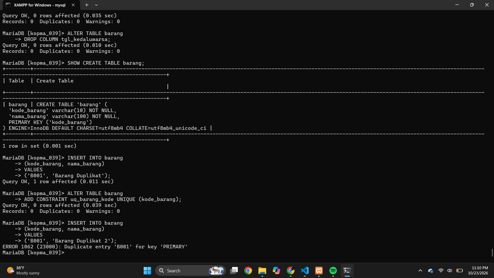
```

---

### 10.3 Push ke GitHub

File berhasil dikirim ke repository GitHub menggunakan:

```powershell
git push
```

Hasil menunjukkan:

```text
7c69580..879c3b0  main -> main
```

Artinya commit berhasil dikirim ke branch `main` pada repository GitHub.

**Screenshot SS79**

```md
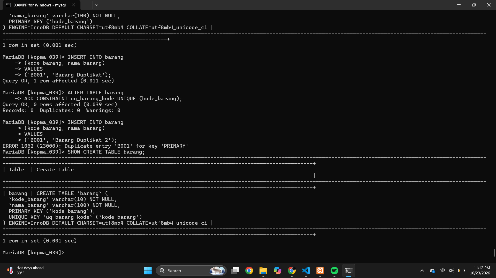
```

---

# BAB XI  
## ANALISIS

### 11.1 Analisis Error 1062

Error `1062` terjadi ketika memasukkan data dengan nilai yang sudah digunakan sebagai Primary Key atau UNIQUE.

Pada pengujian, kode petugas `K01` dimasukkan kembali sehingga MariaDB menolaknya.

Hal tersebut membuktikan bahwa constraint Primary Key berhasil menjaga keunikan data.

---

### 11.2 Analisis Error 1452

Error `1452` terjadi ketika data yang dimasukkan pada Foreign Key tidak memiliki pasangan pada tabel induk.

Contohnya penggunaan kode petugas `XXX`, nomor anggota `XXX`, atau kode barang `XXX`.

Dengan adanya Foreign Key, database tidak membiarkan transaksi memiliki referensi ke data yang tidak tersedia.

---

### 11.3 Analisis Error 4025

Error `4025` muncul karena nilai yang dimasukkan tidak memenuhi kondisi CHECK.

Pada `detail_penjualan` dan `detail_pembelian`, nilai quantity `0` ditolak karena aturan:

```sql
CHECK (qty > 0)
```

Aturan tersebut menjaga agar jumlah barang dalam transaksi tidak bernilai nol atau negatif.

---

### 11.4 Hubungan Constraint dengan Aturan Bisnis

| Constraint | Fungsi | Aturan yang dijaga |
|---|---|---|
| PRIMARY KEY | Identitas unik | Mencegah identitas ganda |
| UNIQUE | Nilai harus unik | Mencegah kode duplikat |
| FOREIGN KEY | Menjaga relasi | Referensi induk harus tersedia |
| NOT NULL | Nilai wajib ada | Data penting tidak boleh kosong |
| DEFAULT | Nilai awal otomatis | Mempermudah pengisian data |
| CHECK | Membatasi nilai | Quantity harus > 0 dan stok tidak negatif |

---

### 11.5 Analisis ON DELETE CASCADE

`ON DELETE CASCADE` digunakan pada hubungan kepala transaksi dengan detail transaksi.

Apabila suatu transaksi dihapus, detail transaksi yang bergantung pada transaksi tersebut juga dapat dihapus.

Namun, pada tabel barang tidak digunakan CASCADE untuk menghapus barang secara otomatis karena barang merupakan data master. Data barang dapat digunakan pada banyak transaksi sehingga penghapusan barang dapat menyebabkan hilangnya referensi dan mengganggu riwayat transaksi.

---

### 11.6 Analisis Urutan DROP TABLE

Tabel anak harus dihapus sebelum tabel induk karena Foreign Key masih mengacu pada tabel induk.

Urutan penghapusan yang benar adalah:

```text
detail_pembelian
detail_penjualan
pembelian
penjualan
pemasok
barang
anggota
petugas
```

Jika tabel induk dihapus terlebih dahulu ketika masih memiliki tabel anak yang merujuk kepadanya, MariaDB dapat memberikan error `1451`.

---

# BAB XII  
## LATIHAN DAN MODIFIKASI

### 12.1 CHECK Stok Minimum

Aturan tambahan yang diminta adalah memastikan `stok_min_barang` tidak boleh negatif.

Constraint dapat ditambahkan menggunakan:

```sql
ALTER TABLE barang
ADD CONSTRAINT ck_barang_stok_min
CHECK (stok_min_barang >= 0);
```

Pengujian dapat dilakukan dengan mencoba memberikan nilai negatif.

```sql
UPDATE barang
SET stok_min_barang = -1
WHERE kode_barang = 'B001';
```

Perintah tersebut seharusnya ditolak oleh MariaDB karena melanggar constraint CHECK.

---

### 12.2 ON DELETE SET NULL

Foreign Key anggota pada tabel penjualan dapat diubah agar ketika data anggota dihapus, nilai `id_anggota` pada penjualan menjadi NULL.

Konsepnya menggunakan:

```sql
ON DELETE SET NULL
```

Penggunaan SET NULL sesuai dengan konsep bahwa pembeli umum dapat memiliki `id_anggota` NULL. Namun penerapannya harus mempertimbangkan kebutuhan penyimpanan riwayat transaksi dan kebijakan perlindungan data pribadi.

---

# BAB XIII  
## KESIMPULAN

Berdasarkan praktikum Modul 5, database Kopma `kopma_039` berhasil dibangun menggunakan Data Definition Language pada MariaDB. Database memiliki delapan tabel yang saling berhubungan dan menggunakan berbagai constraint untuk menjaga integritas data.

Primary Key dan UNIQUE digunakan untuk mencegah data duplikat. Foreign Key menjaga hubungan antar tabel agar referensi data selalu valid. CHECK digunakan untuk memastikan nilai quantity memenuhi aturan yang telah ditentukan.

Hasil pengujian menghasilkan beberapa error, yaitu `1062`, `1452`, dan `4025`. Error tersebut membuktikan bahwa MariaDB berhasil menolak data yang melanggar aturan database.

Perubahan struktur tabel juga berhasil dilakukan menggunakan `ALTER TABLE`, yaitu dengan menambahkan dan menghapus kolom `tgl_kedaluwarsa`. Struktur tabel kemudian diperiksa menggunakan `SHOW CREATE TABLE` dan seluruh tabel diperiksa menggunakan `SHOW TABLES`.

Database juga dibandingkan melalui phpMyAdmin Designer untuk memastikan hubungan antar tabel sesuai dengan rancangan ERD.

File DDL proyek berhasil disimpan dan diunggah menggunakan Git dengan commit:

```text
879c3b0 p05: ddl kopma
```

Dengan demikian, kegiatan praktikum Modul 5 mengenai pembangunan struktur database menggunakan DDL dan penerapan constraint telah berhasil dilaksanakan.

---

# PERNYATAAN PENGGUNAAN AI

Dalam penyusunan laporan Praktikum Basis Data Modul 5 ini, saya menggunakan bantuan Artificial Intelligence (AI) sebagai alat bantu dalam memahami materi, menyusun struktur laporan, menjelaskan konsep DDL dan constraint, serta membantu merapikan penulisan laporan.

Penggunaan AI tidak menggantikan proses praktikum yang dilakukan secara langsung. Seluruh proses pembuatan database, eksekusi perintah SQL, pengujian constraint, pemeriksaan struktur tabel, penggunaan phpMyAdmin Designer, serta proses Git dan GitHub dilakukan berdasarkan hasil praktikum yang telah dikerjakan.

Saya bertanggung jawab untuk memeriksa kembali isi laporan, kode SQL, hasil pengujian, dan bukti screenshot sebelum laporan dikumpulkan.

