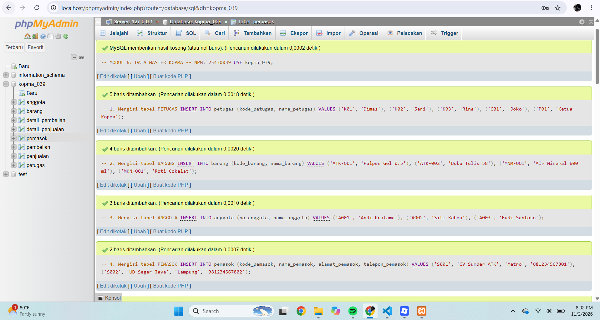
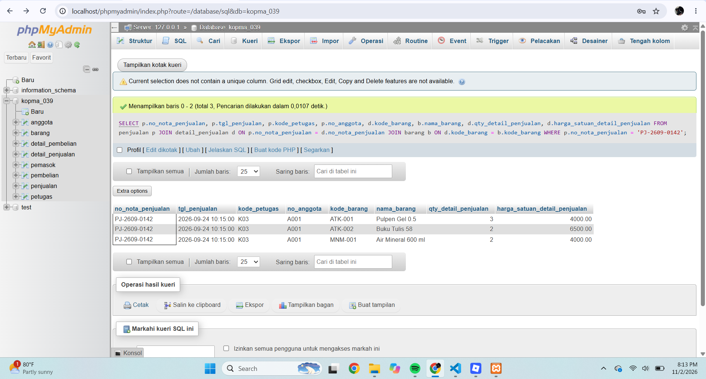
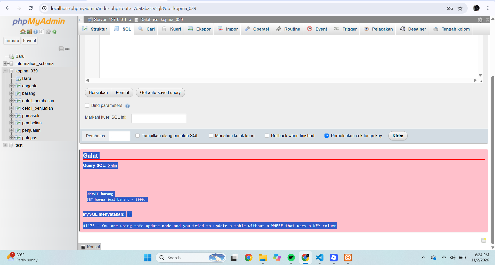
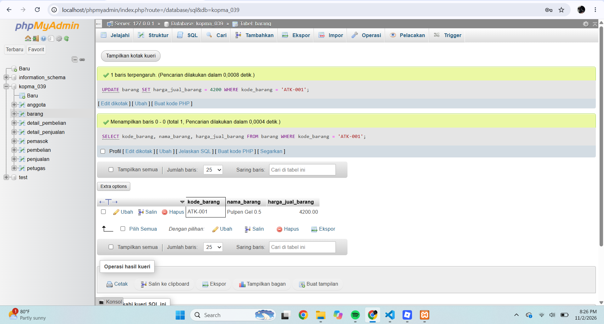
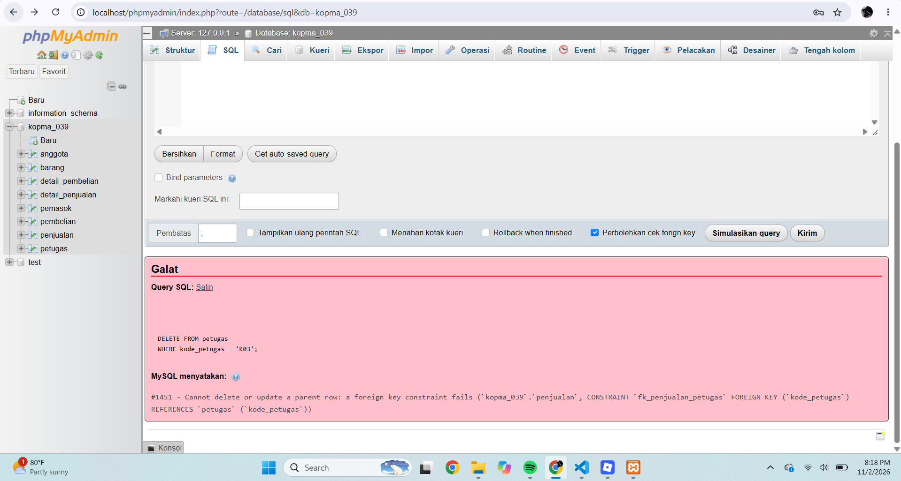
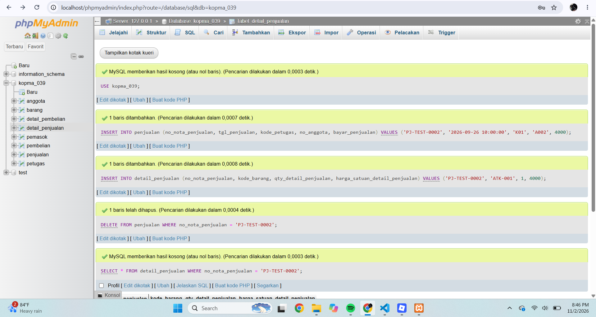
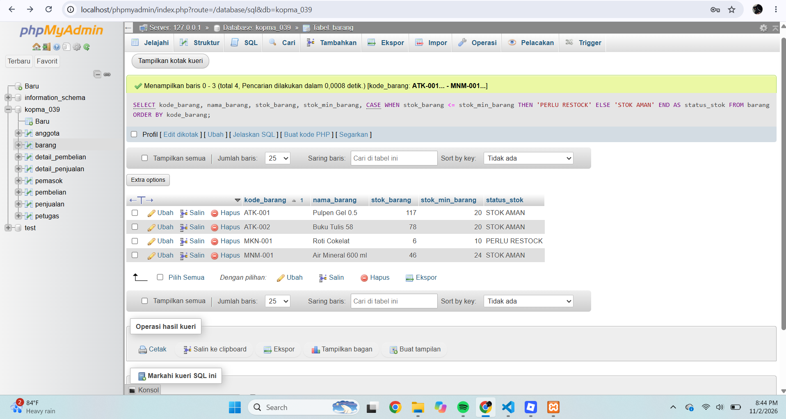
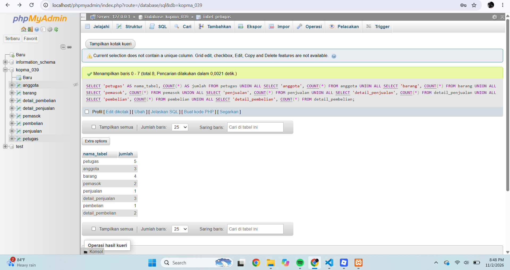

# LAPORAN PRAKTIKUM BASIS DATA
## MODUL 6 – PENGISIAN DATA DAN PENGUJIAN DATABASE KOPMA

**Nama:** Fadillah Doni Saputra  
**NPM:** 25430039  
**Mata Kuliah:** Basis Data  
**Dosen Pengampu:** Dedi Irawan, S.Kom., M.T.I.  
**Kelas:** B  
**Pertemuan:** 6  
**Tanggal:** 3 November 2026

---

## 1. Tujuan Praktikum

Praktikum Modul 6 bertujuan untuk:

1. Mengisi tabel database dengan data master.
2. Membuat transaksi penjualan dan pembelian.
3. Menguji hubungan antar tabel menggunakan Foreign Key.
4. Menguji fitur ON DELETE CASCADE.
5. Menguji keamanan perubahan data menggunakan SQL Safe Updates.
6. Memeriksa jumlah data dan kondisi stok barang.

## 2. Persiapan Database

Database yang digunakan adalah `kopma_039` dengan delapan tabel, yaitu:

- petugas
- anggota
- barang
- pemasok
- penjualan
- detail_penjualan
- pembelian
- detail_pembelian

Struktur database menggunakan Primary Key, Foreign Key, dan beberapa batasan (constraint) untuk menjaga konsistensi data.

## 3. Pengisian Data Master

Data master dimasukkan ke dalam database sebagai dasar untuk melakukan transaksi penjualan dan pembelian.

Data yang berhasil dimasukkan adalah:

| Tabel | Jumlah Data |
|---|---:|
| Petugas | 5 |
| Anggota | 3 |
| Barang | 4 |
| Pemasok | 2 |

**Gambar 1. Bukti pengisian data master**

## 4. Pengujian Transaksi

### 4.1 Transaksi Penjualan

Dibuat transaksi penjualan dengan nomor nota `PJ-2609-0142` pada tanggal 24 September 2026 pukul 10.15.

Transaksi menggunakan tiga jenis barang, yaitu:

- ATK-001 sebanyak 3 unit.
- ATK-002 sebanyak 2 unit.
- MNM-001 sebanyak 2 unit.

Setelah transaksi dimasukkan, stok barang dikurangi sesuai jumlah barang yang terjual.

**Gambar 2. Bukti transaksi penjualan**

### 4.2 Transaksi Pembelian

Dibuat transaksi pembelian dengan nomor nota `PB-2609-0001` pada tanggal 25 September 2026 pukul 09.00.

Transaksi pembelian berisi:

- ATK-001 sebanyak 50 unit.
- ATK-002 sebanyak 30 unit.

Transaksi pembelian berhasil dimasukkan ke dalam database beserta detail barangnya.

## 5. Pengujian Database

### 5.1 Pengujian SQL Safe Updates

Pengujian dilakukan dengan mengaktifkan `sql_safe_updates`. Perintah UPDATE yang tidak memenuhi ketentuan keamanan ditolak oleh MariaDB.

Selanjutnya dilakukan UPDATE menggunakan kondisi berdasarkan kode barang dan berhasil dijalankan.

**Gambar 3. Bukti pengujian SQL Safe Updates**

**Gambar 4. Bukti UPDATE aman**

### 5.2 Pengujian Foreign Key

Dilakukan percobaan menghapus petugas yang masih memiliki hubungan dengan transaksi penjualan.

Database menolak penghapusan tersebut karena masih terdapat data yang merujuk pada petugas tersebut. Hal ini menunjukkan bahwa Foreign Key berfungsi menjaga hubungan antar tabel.

**Gambar 5. Bukti pengujian Foreign Key**

### 5.3 Pengujian ON DELETE CASCADE

Dilakukan pengujian menggunakan transaksi sementara `PJ-TEST-0002`.

Setelah data transaksi utama dihapus, data detail penjualan yang terhubung ikut terhapus secara otomatis. Hasil pemeriksaan menunjukkan bahwa detail untuk nomor nota tersebut sudah tidak ditemukan.

**Gambar 6. Bukti pengujian ON DELETE CASCADE**

### 5.4 Pemeriksaan Stok Minimum

Pemeriksaan dilakukan dengan membandingkan stok barang dengan stok minimum.

Hasil pemeriksaan menunjukkan bahwa barang MKN-001 memiliki stok sebanyak 6 unit, sedangkan stok minimumnya 10 unit. Oleh karena itu, barang tersebut terdeteksi perlu dilakukan restock.

**Gambar 7. Bukti pemeriksaan stok minimum**

## 6. Hasil Pengujian

| Pengujian | Hasil Aktual | Status |
|---|---|---|
| Pengisian data master | Data berhasil dimasukkan | Berhasil |
| Transaksi penjualan | Transaksi dan detail berhasil dimasukkan | Berhasil |
| Transaksi pembelian | Transaksi dan detail berhasil dimasukkan | Berhasil |
| SQL Safe Updates | UPDATE tidak aman ditolak | Berhasil |
| UPDATE aman | Perubahan harga barang berhasil | Berhasil |
| Foreign Key | Penghapusan petugas yang masih direferensikan ditolak | Berhasil |
| ON DELETE CASCADE | Detail ikut terhapus ketika transaksi utama dihapus | Berhasil |
| Pemeriksaan stok minimum | Barang MKN-001 terdeteksi perlu restock | Berhasil |

## 7. Jumlah Data Akhir

Berdasarkan pemeriksaan jumlah data, diperoleh hasil sebagai berikut:

| Tabel | Jumlah Data |
|---|---:|
| Petugas | 5 |
| Anggota | 3 |
| Barang | 4 |
| Pemasok | 2 |
| Penjualan | 1 |
| Detail Penjualan | 3 |
| Pembelian | 1 |
| Detail Pembelian | 2 |

**Gambar 8. Bukti jumlah data akhir**

## 8. Bukti Git

Seluruh perubahan Modul 6 telah disimpan menggunakan Git dan dikirim ke GitHub.

- Repository: https://github.com/fadillahdonisaputttraa-commits/basisdata-25430039
- Branch: `main`
- Commit: `5836cf9`
- Pesan commit: `p06: data dan uji kopma`

Hasil pemeriksaan Git menunjukkan bahwa branch `main` sudah sinkron dengan `origin/main` dan tidak terdapat perubahan yang belum disimpan.

## 9. Kesimpulan

Berdasarkan praktikum Modul 6, pengisian data master, pembuatan transaksi penjualan dan pembelian, serta pengujian beberapa constraint database telah berhasil dilakukan.

Pengujian menunjukkan bahwa Foreign Key dapat mencegah penghapusan data yang masih digunakan, ON DELETE CASCADE dapat menghapus data detail secara otomatis, dan SQL Safe Updates dapat membantu mencegah perubahan data yang tidak aman.

Dengan demikian, database KOPMA telah berhasil diisi dan diuji berdasarkan tahapan praktikum Modul 6 yang telah dikerjakan.

## 10. Pernyataan Penggunaan Artificial Intelligence (AI)

Dalam penyusunan laporan Praktikum Basis Data Modul 6 ini, saya menggunakan bantuan Artificial Intelligence (AI), yaitu ChatGPT, sebagai alat bantu untuk memahami materi, menyusun penjelasan, merapikan penulisan laporan, serta membantu memahami perintah SQL.

Seluruh proses praktikum, pengoperasian database, pelaksanaan pengujian, dan pengambilan bukti screenshot dilakukan berdasarkan kegiatan praktikum yang telah saya kerjakan.

Penggunaan AI dilakukan sebagai sarana pendukung pembelajaran, bukan sebagai pengganti proses pengerjaan praktikum dan pemahaman materi.