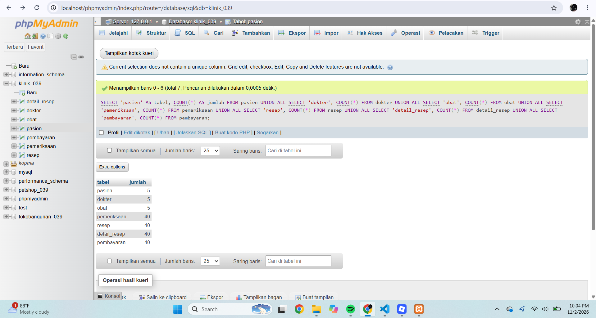
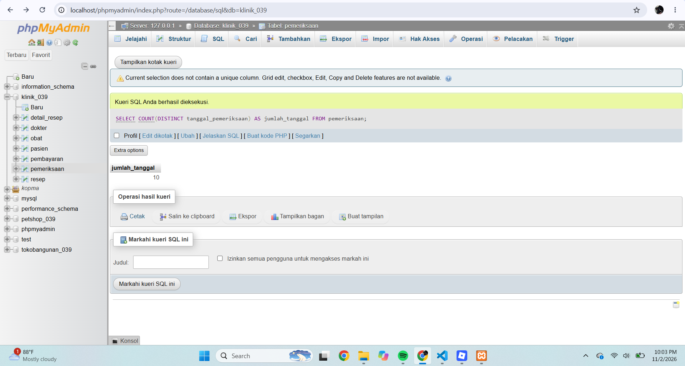
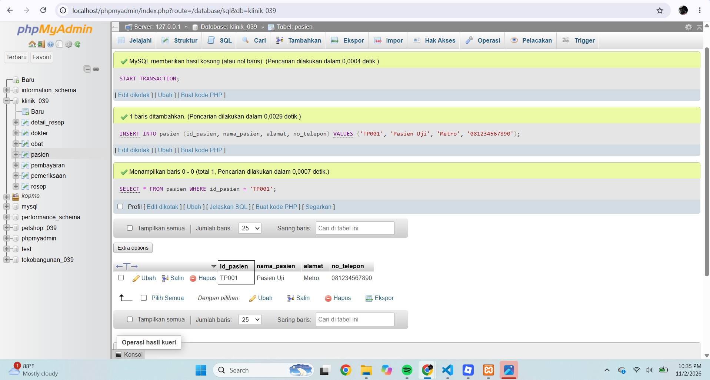
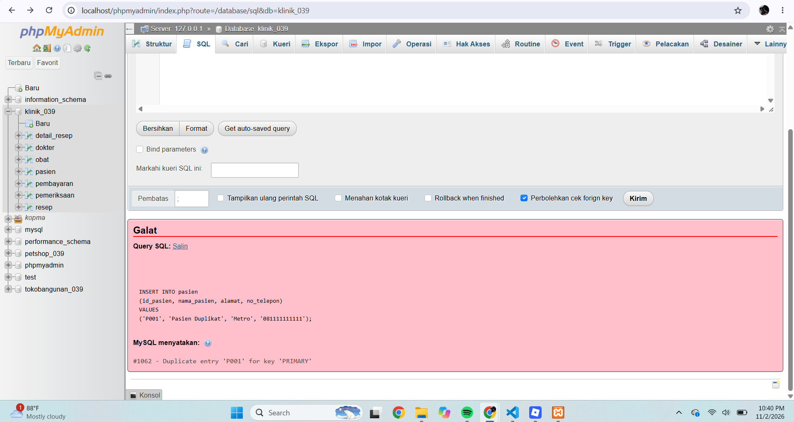
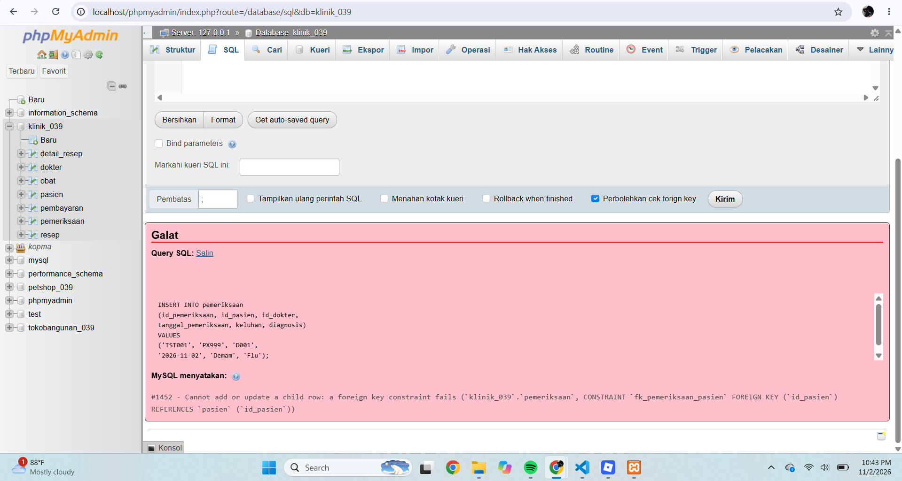
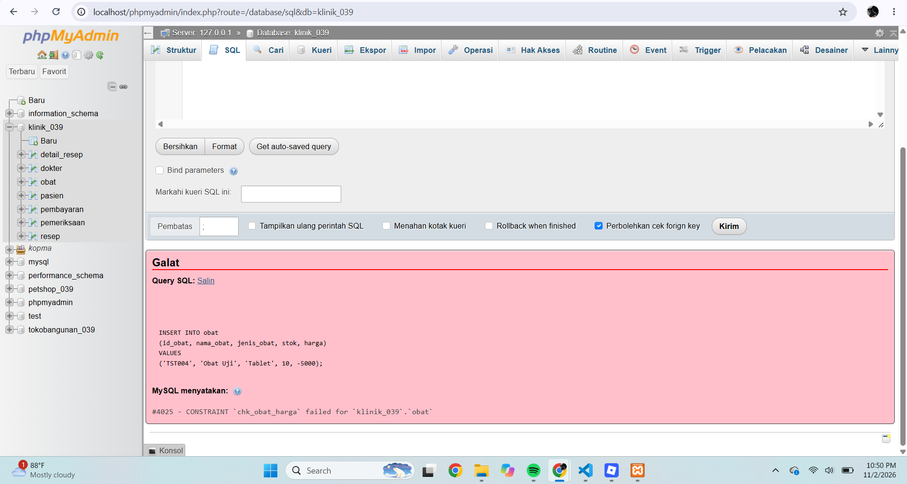
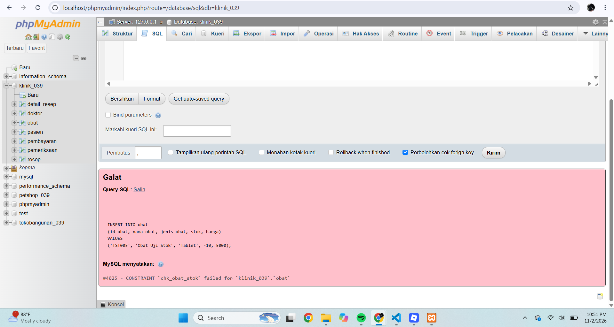
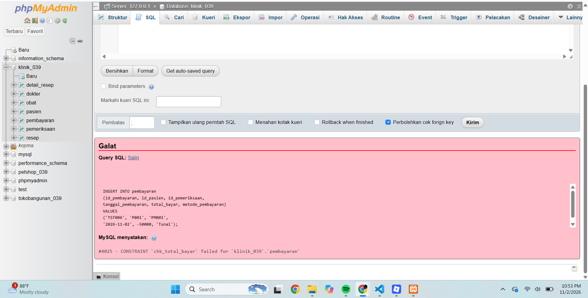
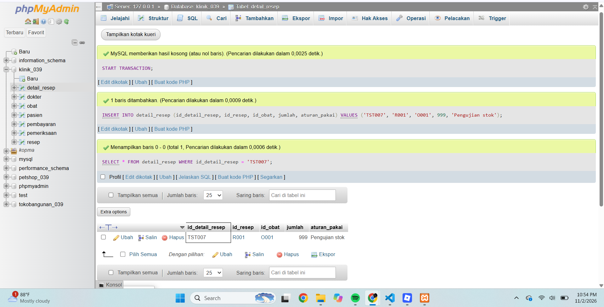
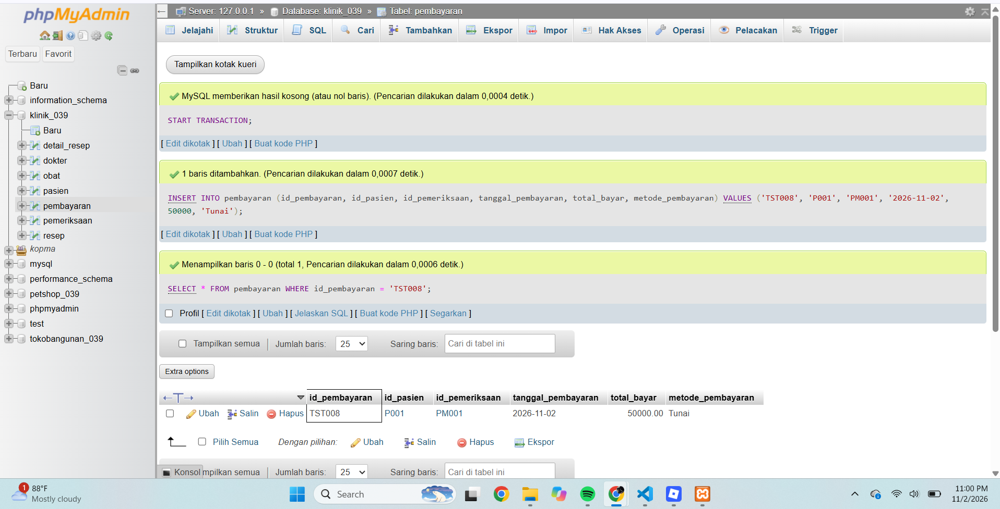

# PENGUJIAN DATABASE KLINIK DS SEHAT

**Nama:** Fadillah Doni Saputra  
**NPM:** 25430039  
**Kelas:** B  
**Mata Kuliah:** Basis Data  
**Dosen Pengampu:** Dedi Irawan, S.Kom., M.T.I.  
**Tanggal:** 2 November 2026

## 1. Tujuan Pengujian

Pengujian dilakukan untuk memastikan database Klinik DS Sehat berjalan sesuai rancangan, relasi antartabel berfungsi, serta aturan integritas data dapat diterapkan.

## 2. Hasil Pengujian Jumlah Data

Pemeriksaan jumlah data dilakukan untuk memastikan seluruh tabel telah terisi sesuai ketentuan Milestone Proyek 6.

Hasil pemeriksaan menunjukkan:

| No. | Nama Tabel | Jumlah Data |
|---|---|---:|
| 1 | Pasien | 5 |
| 2 | Dokter | 5 |
| 3 | Obat | 5 |
| 4 | Pemeriksaan | 40 |
| 5 | Resep | 40 |
| 6 | Detail Resep | 40 |
| 7 | Pembayaran | 40 |
| | **Total** | **175** |

**Bukti screenshot jumlah data seluruh tabel:**

## 3. Pemeriksaan Jumlah Tanggal

Pemeriksaan dilakukan menggunakan fungsi `COUNT(DISTINCT tanggal_pemeriksaan)` untuk menghitung jumlah tanggal pemeriksaan yang berbeda.

Hasil menunjukkan terdapat 10 tanggal pemeriksaan. Dengan demikian, ketentuan minimal tiga tanggal berbeda telah terpenuhi.

**Bukti screenshot jumlah tanggal pemeriksaan:**

## 4. Hasil Aktual Skenario Pengujian

Pengujian dilakukan menggunakan phpMyAdmin untuk memastikan data valid dapat dimasukkan dan data yang melanggar aturan integritas ditolak oleh database.

| No. | Skenario Pengujian | Hasil Aktual | Status |
|---|---|---|---|
| 1 | Menambahkan pasien valid | Data pasien TP001 berhasil ditambahkan | Berhasil |
| 2 | ID pasien duplikat | Ditolak dengan error #1062 (PRIMARY KEY) | Berhasil |
| 3 | ID pasien tidak ditemukan | Ditolak oleh `fk_pemeriksaan_pasien` | Berhasil |
| 4 | ID dokter tidak ditemukan | Ditolak oleh `fk_pemeriksaan_dokter` | Berhasil |
| 5 | Jumlah obat negatif (-5) | Ditolak oleh `chk_detail_jumlah` | Berhasil |
| 6 | Harga obat negatif (-5000) | Ditolak oleh `chk_obat_harga` | Berhasil |
| 7 | Stok obat negatif (-10) | Ditolak oleh `chk_obat_stok` | Berhasil |
| 8 | Total pembayaran negatif (-50000) | Ditolak oleh `chk_total_bayar` | Berhasil |
| 9 | Jumlah resep melebihi stok (999) | Data diterima karena aturan stok belum diterapkan | Design Debt |
| 10 | Menambahkan pembayaran valid | Data pembayaran TST008 berhasil ditambahkan | Berhasil |

### 4.1 Pengujian Pasien Valid

Pengujian dilakukan dengan menambahkan data pasien menggunakan ID `TP001`. Hasil menunjukkan data berhasil dimasukkan.

### 4.2 Pengujian ID Pasien Duplikat

Pengujian dilakukan dengan menggunakan kembali ID pasien `P001`. Database menolak data karena ID tersebut sudah digunakan sebagai primary key.

### 4.3 Pengujian Foreign Key Pasien

Pengujian menggunakan ID pasien `PX999` yang tidak tersedia di tabel pasien. Database menolak penambahan data karena melanggar foreign key `fk_pemeriksaan_pasien`.

### 4.4 Pengujian Foreign Key Dokter

Pengujian menggunakan ID dokter `DX999` yang tidak tersedia di tabel dokter. Database menolak penambahan data karena melanggar foreign key `fk_pemeriksaan_dokter`.

### 4.5 Pengujian Jumlah Obat Negatif

Pengujian dilakukan dengan memasukkan jumlah obat sebesar -5 pada tabel detail_resep. Database menolak data karena melanggar constraint `chk_detail_jumlah`.

### 4.6 Pengujian Harga Obat Negatif

Pengujian dilakukan dengan memasukkan harga obat sebesar -5000. Database menolak data karena melanggar constraint `chk_obat_harga`.

### 4.7 Pengujian Stok Obat Negatif

Pengujian dilakukan dengan memasukkan stok obat sebesar -10. Database menolak data karena melanggar constraint `chk_obat_stok`.

### 4.8 Pengujian Total Pembayaran Negatif

Pengujian dilakukan dengan memasukkan total pembayaran sebesar -50000. Database menolak data karena melanggar constraint `chk_total_bayar`.

### 4.9 Pengujian Design Debt

Pengujian dilakukan dengan memasukkan jumlah obat sebanyak 999 meskipun stok obat tidak mencukupi. Database masih menerima data tersebut karena aturan pembatasan jumlah resep berdasarkan stok belum diterapkan.

### 4.10 Pengujian Pembayaran Valid

Pengujian dilakukan dengan memasukkan pembayaran sebesar Rp50.000 menggunakan metode tunai. Database berhasil menerima data pembayaran dengan ID `TST008`.

**Catatan:** Pengujian yang menggunakan transaksi dibatalkan kembali dengan perintah `ROLLBACK`, sehingga data pengujian tidak menetap di database utama.

## 5. Design Debt Modul 14

Aturan bisnis yang belum diterapkan adalah pencegahan jumlah obat yang diresepkan melebihi stok obat yang tersedia.

Saat ini database belum memiliki trigger atau mekanisme khusus untuk memvalidasi jumlah obat terhadap stok yang tersedia. Hal ini dibuktikan melalui pengujian pada skenario nomor 9, ketika database masih menerima jumlah resep sebanyak 999.

Aturan tersebut dicatat sebagai design debt dan direncanakan untuk diperbaiki pada Modul 14.

## 6. Kesimpulan

Berdasarkan hasil pengujian, database Klinik DS Sehat memiliki tujuh tabel yang saling berhubungan. Seluruh tabel telah terisi sesuai jumlah yang direncanakan, dengan total 175 data dan 10 tanggal pemeriksaan berbeda.

Pengujian menunjukkan bahwa primary key, foreign key, dan constraint berhasil menolak data yang tidak sesuai. Data valid juga berhasil dimasukkan. Namun, aturan pembatasan jumlah resep berdasarkan stok masih perlu dikembangkan pada Modul 14.

## 7. Pernyataan Penggunaan AI

Dalam pengerjaan tugas ini, saya menggunakan bantuan Artificial Intelligence (AI) sebagai alat pendukung untuk memahami materi, menyusun skenario pengujian, membantu penulisan dokumentasi, dan memeriksa struktur kode SQL.

Seluruh proses pengerjaan, penerapan kode, pemeriksaan hasil, dan tanggung jawab atas tugas ini tetap berada pada saya sebagai mahasiswa.